**HARARE INSTITUTE OF TECHNOLOGY**

\[SOFTWARE ENGINEERING / COMPUTER SCIENCE: confirm department\]

**PHARMASENSE**

**A Decision-Intelligence System for Multi-Branch Pharmacies in Harare Metropolitan Province**

*Interaction screening at the counter, demand forecasting at the buying desk, and live decision support at head office*

By

**KUPAKWASHE CHIKATA**

Registration number: \[R000000X\]

A project documentation submitted in partial fulfilment of the requirements for the degree of Bachelor of Technology (Honours) in Computer Science

Supervisor: \[Name of supervisor\]

Harare, Zimbabwe

**Draft v1: October 2026**

DECLARATION

I, Kupakwashe Chikata, registration number \[R000000X\], declare that this project documentation titled “PharmaSense: A Decision-Intelligence System for Multi-Branch Pharmacies in Harare Metropolitan Province” is my own original work. It has not been submitted before for any degree or examination at any other institution. All sources used or quoted have been acknowledged by means of complete references in IEEE style.

Signature: \_\_\_\_\_\_\_\_\_\_\_\_\_\_\_\_\_\_\_\_\_\_\_\_\_\_\_\_\_\_ Date: \_\_\_\_\_\_\_\_\_\_\_\_\_\_\_\_\_\_\_\_

Supervisor’s approval. This documentation has been submitted with my approval as the project supervisor.

Name: \[Supervisor\] Signature: \_\_\_\_\_\_\_\_\_\_\_\_\_\_\_\_\_\_\_\_\_\_ Date: \_\_\_\_\_\_\_\_\_\_\_\_\_\_\_\_\_\_\_\_

DEDICATION

*\[To be completed by the author\]*

ACKNOWLEDGEMENTS

\[To be completed by the author. Suggested content: thanks to the project supervisor for guidance; to the pharmacists and pharmacy managers who give their time for interviews and observation; to the clinical pharmacists who validate the interaction rules; to the Department staff at Harare Institute of Technology; and to family and friends for their support.\]

PREFACE

This document is the project documentation for the HIT 400 final-year project, PharmaSense. It is organised according to the Harare Institute of Technology project documentation guide. This first draft covers the pre-chapter pages and Chapters One to Four: Introduction, Literature Review, Analysis and Design. Chapter Five (Implementation and Testing) and Chapter Six (Conclusions and Recommendations) will follow once the system is built and evaluated.

Two points of reading guidance apply. First, fieldwork has not yet taken place, so the description of the existing system in Chapter Three is derived from the problem analysis and published evidence and is marked for validation. Second, the screens in Chapter Four and Appendix B are design prototypes using sample data; they are not output from the finished system, and no performance results are reported in this draft.

The report is written for examiners, the supervisor and pharmacy practitioners. Readers interested only in the design may start at Chapter Four, which refers back to the requirements of Chapter Three.

ABSTRACT

Pharmacy chains in Harare make three recurring decisions that carry clinical and financial risk: whether a basket of medicines is safe for a patient at the counter, what and how much to buy, and how to see and steer the whole chain. Today these decisions rely on memory, experience and static month-end reports. Available pharmacy software mostly records stock and sales but does not screen interactions with graded alerts, forecast demand with a transparent method, or recommend stock moves between branches, and published studies address these pieces separately.

This project designs PharmaSense, a decision-intelligence platform for multi-branch pharmacies, built on one shared data foundation of sales, batches and stock. Three modules support the three decisions. First, a rule-based drug interaction checker with severity-graded alerts interrupts only for serious findings and logs every override. Second, a demand forecasting module in Python with scikit-learn and a PostgreSQL feature pipeline produces forecasts with prediction intervals and is compared with seasonal-naive and intermittent-demand baselines. Third, a decision-support layer with a scoring algorithm, FastAPI and React provides real-time dashboards, ranked purchase and transfer recommendations, and template-based smart reports. An optional scan-assisted capture channel reads barcodes and prescription images into draft lines that a pharmacist must confirm before screening.

The document reports the background, objectives with measurable criteria, a literature review of 46 sources that identifies the research gap, an analysis of the existing system and the requirements of the proposed system, and the full design: context and data flow diagrams, architecture, database, class, package and sequence diagrams, pseudocode and interface prototypes. The system is designed to be offline-tolerant and to follow the Zimbabwean Cyber and Data Protection Act. Implementation and evaluation are planned for later chapters; no results are claimed here.

**Keywords:** pharmacy; decision support; drug interaction screening; demand forecasting; inter-branch transfers; Zimbabwe.

TABLE OF CONTENTS

**DECLARATION** ii

**DEDICATION** iii

**ACKNOWLEDGEMENTS** iv

**PREFACE** v

**ABSTRACT** vi

**TABLE OF CONTENTS** vii

**LIST OF FIGURES** ix

**LIST OF TABLES** x

**LIST OF ABBREVIATIONS** xi

**CHAPTER ONE: INTRODUCTION** 1

> 1.1 Introduction 1
>
> 1.2 Background of the Study 1
>
> 1.3 Problem Statement 2
>
> 1.4 Aim of the Study 3
>
> 1.5 Objectives of the Study 3
>
> 1.6 Research Questions 4
>
> 1.7 Research Hypotheses 5
>
> 1.8 Justification and Significance of the Study 5
>
> 1.9 Scope, Delimitations, Assumptions and Limitations 5
>
> 1.10 Proposed Tools and Technologies 7
>
> 1.11 Feasibility Study 7
>
> 1.12 Project Plan 10
>
> 1.13 Organisation of the Dissertation 12
>
> 1.14 Chapter Summary 12

**CHAPTER TWO: LITERATURE REVIEW** 13

> 2.1 Introduction 13
>
> 2.2 Theoretical and Conceptual Framework 13
>
> 2.3 Related Work 15
>
> 2.4 Summary of Reviewed Studies 20
>
> 2.5 Where the Literature Stops 21
>
> 2.6 Research Gap 25
>
> 2.7 Chapter Conclusion 26

**CHAPTER THREE: ANALYSIS** 27

> 3.1 Introduction 27
>
> 3.2 Information Gathering Tools 27
>
> 3.3 Description of the Existing System 28
>
> 3.4 Data Analysis of the Existing System 29
>
> 3.5 Evaluation of Alternative Systems 32
>
> 3.6 Functional Analysis of the Proposed System 33
>
> 3.7 Data Requirements 40
>
> 3.8 Chapter Summary 40

**CHAPTER FOUR: DESIGN** 41

> 4.1 Introduction 41
>
> 4.2 System Diagrams 41
>
> 4.3 Architectural Design 49
>
> 4.4 Database Design 55
>
> 4.5 Program Design 59
>
> 4.6 Interface Design 69
>
> 4.7 Chapter Summary 71

**REFERENCES** 73

**APPENDIX A: DATA COLLECTION INSTRUMENTS** 77

> A.1 Consent statement 77
>
> A.2 Interview guide for pharmacists, pharmacy technicians and dispensers 77
>
> A.3 Interview guide for branch managers, buyers and head-office managers 77
>
> A.4 Questionnaire for dispensers and cashiers 78
>
> A.5 Observation checklist 79
>
> A.6 Document review sheet 79

**APPENDIX B: ADDITIONAL INTERFACE PROTOTYPES** 80

**APPENDIX C: DETAILED ENTITY-RELATIONSHIP DIAGRAMS** 82

LIST OF FIGURES

Figure 1.1: Gantt chart of the 28-week project plan 11

Figure 2.1: Conceptual framework of PharmaSense: three decisions on one data foundation 15

Figure 2.2: From what the studies show, to where the authors stop, to what PharmaSense adds 23

Figure 3.1: Context diagram of the existing system 30

Figure 3.2: Level 0 data flow diagram of the existing system 31

Figure 3.3: Use case diagram: dispensing and patient safety 36

Figure 3.4: Use case diagram: inventory, procurement and transfers 37

Figure 3.5: Use case diagram: management intelligence and administration 38

Figure 4.1: Context diagram of PharmaSense 42

Figure 4.2: Level 0 data flow diagram of PharmaSense 44

Figure 4.3: Level 1 data flow diagram: dispensing with interaction screening 47

Figure 4.4: Activity diagram: dispense with interaction screening 48

Figure 4.5: Activity diagram: nightly forecast, transfer and order recommendation 49

Figure 4.6: Logical architecture of PharmaSense 51

Figure 4.7: Deployment and network architecture 53

Figure 4.8: Entity-relationship overview of PharmaSense 56

Figure 4.9: Package diagram 60

Figure 4.10: Class diagram: core domain 62

Figure 4.11: Class diagram: intelligence layer 63

Figure 4.12: Sequence diagram: dispense with interaction screening 64

Figure 4.13: Sequence diagram: nightly forecast, scoring and recommendation 64

Figure 4.14: Scan-assisted capture pipeline 68

Figure 4.15: Prototype: point of sale with safety review modal (sample data) 70

Figure 4.16: Prototype: prescription scan review with confidence and pharmacist confirmation (sample data) 70

Figure 4.17: Prototype: demand forecast and suggested purchase order (sample data) 71

Figure 4.18: Prototype: chain dashboard (sample data) 71

Figure B.1: Prototype: inter-branch transfer recommendations (sample data) 80

Figure B.2: Prototype: patient profile with allergies, conditions and current medicines (sample data) 80

Figure B.3: Prototype: smart report with generated narrative (sample data) 80

Figure B.4: Prototype: inventory by batch with expiry status (sample data) 81

Figure B.5: Prototype: interaction rule maintenance and validation (sample data) 81

Figure C.1: ER diagram: master data, inventory and supply 82

Figure C.2: ER diagram: patients, prescriptions and sales 83

Figure C.3: ER diagram: interaction rules, alerts, forecasts, reports and audit 84

Figure C.4: ER diagram: transfers and stocktake 85

LIST OF TABLES

Table 1.1: Proposed measurable success criteria for each objective 3

Table 1.2: Research hypotheses 5

Table 1.3: Limitations and how the design mitigates them 6

Table 1.4: Proposed tools and the reason for each choice 7

Table 1.5: Main project risks and responses 8

Table 1.6: Project budget (USD) 8

Table 1.7: Illustrative annual benefit against running cost (assumed values) 9

Table 1.8: Project phases, deliverables and timing 10

Table 2.1: Summary of the principal studies reviewed 20

Table 2.2: Where the core papers stop, and what PharmaSense adds 24

Table 2.3: Research gaps and how PharmaSense responds 25

Table 3.1: Information gathering tools 27

Table 3.2: Problems in the existing system and the objective that addresses each 28

Table 3.3: Weighted evaluation of alternative systems (1 = poor, 5 = strong) 32

Table 3.4: Actors of the proposed system 33

Table 3.5: Functional requirements 33

Table 3.6: Non-functional requirements 35

Table 3.7: Use case specification: dispense with interaction screening (UC04, UC05, UC06, UC07) 39

Table 3.8: Use case specification: forecast demand and review suggested purchase order (UC15, UC16) 39

Table 3.9: Use case specification: inter-branch transfer (UC18, UC19) 39

Table 4.1: Numbered data flows of the level 0 diagram 45

Table 4.2: Technology decisions: alternatives set aside, and the evidence and reasons 52

Table 4.3: Hardware and infrastructure specification 53

Table 4.4: Security and privacy controls 54

Table 4.5: Unnormalised dispensing slip (UNF) 57

Table 4.6: Normalisation steps for the dispensing slip 57

Table 4.7: Data dictionary for key tables 57

Table 4.8: Candidate features for the demand model 58

Table 4.9: Scanning options considered 69

Table 4.10: Interface screens, use cases and requirements 70

Table A.1: Questionnaire items (Likert scale: 1 = Strongly disagree, 2 = Disagree, 3 = Neutral, 4 = Agree, 5 = Strongly agree) 78

Table A.2: Observation checklist for the dispensing counter 79

Table A.3: Document review sheet 79

LIST OF ABBREVIATIONS

|              |                                                         |
|--------------|---------------------------------------------------------|
| **ACID**     | Atomicity, Consistency, Isolation, Durability           |
| **API**      | Application Programming Interface                       |
| **ARIMA**    | Autoregressive Integrated Moving Average                |
| **ATC**      | Anatomical Therapeutic Chemical (classification)        |
| **CSV**      | Comma-Separated Values                                  |
| **FEFO**     | First-Expiry-First-Out                                  |
| **FR / NFR** | Functional Requirement / Non-Functional Requirement     |
| **HIT**      | Harare Institute of Technology                          |
| **IEEE**     | Institute of Electrical and Electronics Engineers       |
| **KPI**      | Key Performance Indicator                               |
| **LSTM**     | Long Short-Term Memory                                  |
| **OTC**      | Over-the-counter                                        |
| **OWASP**    | Open Worldwide Application Security Project             |
| **PIN**      | Personal Identification Number                          |
| **POS**      | Point of Sale                                           |
| **PWA**      | Progressive Web Application                             |
| **ROP**      | Reorder Point                                           |
| **Rx**       | Prescription                                            |
| **S1–S4**    | Severity tiers: contraindicated, major, moderate, minor |
| **SQL**      | Structured Query Language                               |
| **TLS**      | Transport Layer Security                                |
| **UC**       | Use Case                                                |
| **UML**      | Unified Modeling Language                               |
| **UPS**      | Uninterruptible Power Supply                            |
| **VPS**      | Virtual Private Server                                  |
| **WAPE**     | Weighted Absolute Percentage Error                      |

CHAPTER ONE: INTRODUCTION

1.1 Introduction

A community pharmacy makes decisions that carry clinical and financial consequences many times a day: whether a basket of medicines is safe for the person in front of the counter, how much of each product to hold and where, and which problems a chain should act on first. In most Zimbabwean retail pharmacy chains these decisions are made from memory, experience and paper or spreadsheet records. This dissertation presents PharmaSense, a multi-branch pharmacy decision-intelligence platform that supports those three decisions with software: a rule-based drug interaction checker at the point of sale, a demand forecasting module on the purchasing side, and a decision-support layer that scores recommendations and presents them in real-time dashboards and smart reports.

Batch-level inventory, point-of-sale and patient records are essential to the system, but they are its foundation rather than its purpose. They supply the data that the three intelligence components need, in the same way that a laboratory information system supplies the data on which clinical reasoning depends. This chapter sets out the background to the study, the problem, the objectives and hypotheses, the justification, the proposed tools, the feasibility study and the project plan.

1.2 Background of the Study

Community pharmacies are often the first and most accessible point of contact with the health system, and dispensing is the last safety barrier between a prescribing decision and the patient. The World Health Organization launched its global patient safety challenge on medication safety in 2017, citing a global cost of medication errors estimated at USD 42 billion a year \[1\]. Medication safety depends heavily on screening for drug–drug interactions, allergies and contraindications, yet the way in which software delivers that screening matters as much as the knowledge behind it. A systematic review found that clinicians overrode between 49% and 96% of drug safety alerts in computerised order entry systems \[2\], and a study of outpatient prescribing found that about 53% of medication alerts were overridden, with roughly half of the overridden alerts judged to have deserved attention \[3\]. In community pharmacy specifically, a field test of 64 pharmacies in Arizona found that only 18 (28%) correctly identified every clinically important interaction without raising false alarms on non-interacting pairs \[4\]. Screening is therefore uneven in coverage and in the quality of its alerts.

The supply side of the same pharmacies faces a different decision problem. Medicine demand is seasonal and can shift sharply during outbreaks; Zimbabwe’s 2018–2019 cholera outbreak recorded 10,730 suspected cases, about 93% of them in Harare \[5\]. Stock that is ordered too late is lost as sales and as care, while stock that is ordered too early expires. Public-sector reporting from 2026 illustrates both failures at once: national medicine availability was reported at 47% in June 2026, below the 50% minimum target, while the national medical stores wrote off about USD 3 million of expired stock in 2025, with internal assessments attributing nearly 80% of those losses to preventable planning and systems failures \[6\]. These figures describe the public sector and are cited only as context; whether retail chains show the same pattern is something this project will measure with chain data.

Commercial pharmacy systems typically automate replenishment through minimum and maximum levels set by the pharmacy for each item \[7\], which reacts to past consumption but does not anticipate a coming surge. Regional platforms such as mPharma demonstrate that analytics-led stock management is valuable in African markets, but they are operated as part of the vendor’s own supply network rather than as software that an independent chain can adopt and adapt \[8\]. Chapter Two reviews these and other sources in detail.

PharmaSense is positioned at the junction of these problems. It treats the pharmacy chain as an organisation that makes three recurring decisions, at the counter, at the buying desk and at head office, and applies a different intelligence component to each (Figure 2.1 in Chapter Two develops this view as the conceptual framework).

1.3 Problem Statement

Pharmacy chains in Harare make three recurring, high-stakes decisions without decision support. At the counter, medicines are dispensed with no automatic check against the patient’s current medicines, allergies and conditions, and over-the-counter sales usually skip clinical review altogether, so the prevention of harmful interactions depends on the memory and workload of the pharmacist. At the buying desk, purchasing relies on the buyer’s experience and on last month’s orders, so fast-moving lines run out during seasonal and outbreak surges while slow-moving lines are overstocked and expire; transfers between branches are arranged informally and are not tracked. At head office, management reports are static, produced after month-end and limited to one branch, so the chain cannot see live sales, stock health, expiry exposure or safety events across all branches. No integrated system available to these chains combines severity-graded interaction screening, demand forecasting, scored stock and transfer recommendations, and real-time chain-wide reporting on one shared data foundation.

1.4 Aim of the Study

The aim of this study is to design, develop and evaluate PharmaSense, a multi-branch pharmacy decision-intelligence system that improves medication safety at the point of sale and supports demand-responsive purchasing and stock coordination across a retail pharmacy chain in Harare Metropolitan Province.

1.5 Objectives of the Study

The study has three specific objectives, each beginning with “To” and each measurable from the finished system:

1.  To design and develop a demand forecasting module in Python using scikit-learn and a PostgreSQL feature pipeline.

2.  To design and develop a rule-based drug interaction checker in Python, using a curated interaction database, with severity-graded alerts and logged overrides.

3.  To design and develop a decision-support layer using a Python scoring algorithm, PostgreSQL, FastAPI and React, providing real-time dashboards and smart reports.

To make each objective measurable, acceptance criteria have been proposed in Table 1.1. They are working targets for agreement with the supervisor and will be confirmed against the data actually obtained in the field; results will be reported in Chapter Five.

**Table 1.1:** Proposed measurable success criteria for each objective

<table>
<colgroup>
<col style="width: 16%" />
<col style="width: 50%" />
<col style="width: 33%" />
</colgroup>
<thead>
<tr class="header">
<th><strong>Objective</strong></th>
<th><strong>Measure and proposed target</strong></th>
<th><strong>How it will be measured</strong></th>
</tr>
</thead>
<tbody>
<tr class="odd">
<td>1. Forecasting</td>
<td>
Weighted absolute percentage error (WAPE) at product-branch-week level at least 10% lower (relative) than a seasonal-naive baseline on a held-out period.

80% prediction interval covers between 75% and 85% of actual weekly demand.

Nightly feature and forecast run completes within 15 minutes for the full chain.
</td>
<td>Time-ordered cross-validation and hold-out test on chain sales data; timing logs.</td>
</tr>
<tr class="even">
<td>2. Interaction checker</td>
<td>
At least 95% of severity S1 and S2 interactions, allergy and condition conflicts in a pharmacist-validated test set of 250 dispensing scenarios are detected (recall).

At least 90% specificity on scenarios with no clinically relevant conflict.

Screening latency of 1 second or less at the 95th percentile for baskets of up to 10 items.

100% of S1 and S2 overrides stored with reason, user and time.

Scan-assisted capture (optional extension): on a test set of 100 prescription images, the correct product is among the top three suggestions for at least 90% of printed lines; handwritten lines are reported without a target; every scanned line is confirmed by a pharmacist before it enters the basket.
</td>
<td>Scenario test set validated by two pharmacists; automated timing tests; inspection of the override log; line-by-line comparison of scan output with pharmacist transcription of the image set.</td>
</tr>
<tr class="odd">
<td>3. Decision-support layer</td>
<td>
A completed sale appears in dashboard KPIs within 5 seconds at the 95th percentile.

At least 80% of 50 sampled transfer and purchase recommendations rated appropriate by two reviewers.

In back-test replay, recommended transfers reduce simulated stock-out days and expiry losses compared with no transfers.

System Usability Scale score of at least 70 from at least 10 users.
</td>
<td>Load and latency tests; blinded expert rating; replay simulation on historical data; usability questionnaire.</td>
</tr>
</tbody>
</table>

1.6 Research Questions

1.  How accurately can a scikit-learn model built on a PostgreSQL feature pipeline forecast weekly product demand per branch compared with simple baselines used in practice?

2.  How completely can a curated, rule-based interaction database with severity grading detect clinically important interactions, allergies and condition conflicts across prescription and over-the-counter sales, and how much interruption does the tiered alerting add to the dispensing workflow?

3.  To what extent can a scoring-based decision-support layer with real-time dashboards and smart reports turn forecasts, stock, expiry and safety data into actions that a chain manager judges appropriate?

1.7 Research Hypotheses

**Table 1.2:** Research hypotheses

| **ID** | **Hypothesis**                                                                                                                                                                                | **Null hypothesis**                                                                    |
|--------|-----------------------------------------------------------------------------------------------------------------------------------------------------------------------------------------------|----------------------------------------------------------------------------------------|
| H1     | A gradient-boosted regression model on engineered calendar, lag, rolling and external-signal features gives a lower WAPE than a seasonal-naive baseline for weekly product-branch demand.     | H1₀: There is no difference in WAPE between the model and the baseline.                |
| H2     | Severity-graded rule-based screening detects at least 95% of S1 and S2 conflicts in the validated test set while interrupting the dispenser on fewer baskets than an alert-everything policy. | H2₀: Detection is below 95%, or the tiered policy does not reduce interruptions.       |
| H3     | Scored transfer and order recommendations lower simulated stock-out days and expiry loss compared with current practice (fixed levels, no tracked transfers).                                 | H3₀: Simulated outcomes under the recommendations are no better than current practice. |

1.8 Justification and Significance of the Study

- **Patients:** protection at the point of sale from harmful combinations, including over-the-counter purchases that are normally outside clinical review, and better availability of medicines when demand surges.

- **Pharmacists and dispensers:** relief of the memory and workload burden through checks that interrupt only when severity warrants, with a rationale and suggested management shown for each alert.

- **Branch managers and buyers:** forward-looking order and transfer suggestions with an explanation, in place of reliance on last month’s orders and phone calls between branches.

- **Chain executives:** a live, chain-wide view of sales, stock health, expiry exposure and safety events, and scheduled reports that explain what changed and what to do about it.

- **The academic community and HIT:** an applied, openly documented reference design for decision-intelligence in resource-constrained pharmacy settings, with forecasting, alerting and scoring evaluated against baselines and reported.

1.9 Scope, Delimitations, Assumptions and Limitations

1.9.1 Scope and delimitations

The study covers the design, development and laboratory and pilot-style evaluation of PharmaSense for retail pharmacy chains in Harare Metropolitan Province. The operational core (batch and expiry inventory, point of sale, patients, suppliers, stocktake and tracked inter-branch transfers) is built to the depth needed to feed the three objectives. Scan-assisted capture (barcode and GS1 DataMatrix reading, and reading of prescription images into draft lines that a pharmacist must confirm) is included as an optional input channel to the dispensing flow; it does not add a fourth objective and does not replace manual entry. The following are outside the scope: electronic prescription exchange with prescribers or national health records; payment gateway and mobile-money integration; accounting and payroll; clinical dosing calculation; machine-learning classification of alert severity; blockchain or decentralised prescription ledgers; and autonomous purchasing that dispatches orders to suppliers without human approval. Several of these are listed as future work in Chapter Six.

1.9.2 Assumptions

- At least one pharmacy chain will provide anonymised sales history covering a minimum of 18 months, or the study will fall back to the data strategy described in Table 1.3.

- Branch staff have, or can be given, a basic web-capable device and basic computer literacy for operating a web-based point of sale.

- Two registered pharmacists will be available to validate interaction rules and test scenarios.

- Outbreak and weather signals are available as periodic downloadable bulletins and can be entered or imported as weekly values.

1.9.3 Limitations and mitigations

**Table 1.3:** Limitations and how the design mitigates them

| **Limitation**                                                   | **Mitigation**                                                                                                                                                                                                                                                                     |
|------------------------------------------------------------------|------------------------------------------------------------------------------------------------------------------------------------------------------------------------------------------------------------------------------------------------------------------------------------|
| Unreliable power and connectivity in some branches               | Offline-tolerant point of sale: a service worker and local queue keep dispensing and interaction screening available from a cached rule set; transactions synchronise when the connection returns (Section 4.3).                                                                   |
| Access to real chain sales data may be delayed or refused        | Early data-sharing agreement in Phase 1; if real data is not obtained, forecasting is developed and tested on a synthetic generator calibrated to public seasonality and then re-run on real data when available. The dissertation will state which data was used for each result. |
| Coverage and severity ratings differ between interaction sources | Curate from open sources with pharmacist validation, record the source and validator for every rule, and report coverage limits openly rather than claim completeness \[9\].                                                                                                       |
| Resistance to extra steps at a busy counter                      | Only S1 and S2 alerts interrupt; S3 and S4 appear as passive notices; screening target of 1 second or less.                                                                                                                                                                        |
| Short project duration (28 weeks)                                | Objectives limited to three; the operational core is kept to what the objectives need; extended features deferred to future work.                                                                                                                                                  |

1.10 Proposed Tools and Technologies

**Table 1.4:** Proposed tools and the reason for each choice

| **Layer**                     | **Tool**                                                                                                                                                                                                          | **Reason**                                                                                                                                                             |
|-------------------------------|-------------------------------------------------------------------------------------------------------------------------------------------------------------------------------------------------------------------|------------------------------------------------------------------------------------------------------------------------------------------------------------------------|
| Programming language          | Python 3.11                                                                                                                                                                                                       | Single language for the forecasting, screening and scoring code and for the API; mature data and machine-learning ecosystem.                                           |
| Forecasting                   | scikit-learn, pandas, NumPy                                                                                                                                                                                       | Required by Objective 1; provides histogram-based gradient boosting, pipelines, cross-validation and permutation importance without extra services.                    |
| Database and feature pipeline | PostgreSQL 16 (SQL views, materialised views)                                                                                                                                                                     | ACID transactions for stock and sales; SQL window functions produce lag and rolling features close to the data; row-level audit via triggers.                          |
| API                           | FastAPI, Pydantic, SQLAlchemy                                                                                                                                                                                     | Required by Objective 3; typed, validated REST interfaces and server-sent events for live dashboards.                                                                  |
| Front end                     | React with a service worker (PWA)                                                                                                                                                                                 | Required by Objective 3; component-based screens; offline queue for the point of sale.                                                                                 |
| Interaction knowledge         | Curated rules loaded from open sources and validated by pharmacists (for example DDInter \[10\]), subject to licence checks                                                                                       | Deterministic, auditable, reproducible checks; no dependence on a paid commercial content licence.                                                                     |
| Scanning (optional extension) | Browser camera with an open-source barcode reader (for example ZXing); an open-source OCR engine such as Tesseract or PaddleOCR, benchmarked in Chapter Five; fuzzy string matching against the product catalogue | Deterministic barcode path for products; assistive text recognition for prescriptions; runs on the pharmacy’s own server so that images are not sent to third parties. |
| Testing and quality           | pytest, Playwright, k6 or Locust, OWASP ZAP                                                                                                                                                                       | Unit and end-to-end tests; load and latency tests; web security scanning.                                                                                              |
| Deployment                    | Ubuntu LTS VPS, Docker, Nginx, TLS                                                                                                                                                                                | Low-cost hosting; repeatable deployment; encrypted transport.                                                                                                          |
| Modelling and documentation   | Graphviz, Mermaid, draw-style UML tools                                                                                                                                                                           | Reproducible UML diagrams under version control.                                                                                                                       |

1.11 Feasibility Study

1.11.1 Technical feasibility

Every component is open-source and in mainstream use. The developer has the Python, SQL and web skills required, and the largest technical risks are data access and the quality of the interaction knowledge rather than the technology. The required computing load is small: nightly forecasting for a chain of a few branches and a few thousand products is a modest tabular problem that histogram-based gradient boosting handles in minutes on a single virtual server, and interaction screening is an indexed lookup. Gradient-boosted trees are also well supported by evidence for tabular data of this size \[11\]. The risk register in Table 1.5 lists the main technical risks and responses.

**Table 1.5:** Main project risks and responses

| **Risk**                                       | **Level** | **Response**                                                                                                                       |
|------------------------------------------------|-----------|------------------------------------------------------------------------------------------------------------------------------------|
| Real sales data not released in time           | High      | Agree data sharing in Weeks 1–4; synthetic fallback; report data provenance.                                                       |
| Interaction rules incomplete or inconsistent   | High      | Prioritise rules for the most-dispensed products; pharmacist validation; display coverage limits.                                  |
| Pharmacist time for validation not available   | Medium    | Book two validators early; budget a consultation fee.                                                                              |
| Handwriting recognition too inaccurate to help | Medium    | Scanning is assistive only and confirmed by a pharmacist; if tests fail, keep barcode and printed-text paths and drop handwriting. |
| Scope growth beyond 28 weeks                   | Medium    | Freeze scope at three objectives; defer extras to future work.                                                                     |
| Connectivity or power failure during testing   | Low       | Offline-tolerant point of sale; local test environment.                                                                            |

1.11.2 Economic feasibility

Table 1.6 gives the revised budget. The cash requirement is USD 1,089; the student’s own effort is valued at USD 5,600 and treated as an in-kind academic contribution. This budget replaces the earlier proposal figures: the security-consultant line was removed because security testing will be done by the student with OWASP ZAP, and the net cash outlay was recalculated from the line items.

**Table 1.6:** Project budget (USD)

| **Item**                                                                              | **Amount (USD)** |
|---------------------------------------------------------------------------------------|------------------|
| Clinical pharmacist consultation (validation of interaction rules and test scenarios) | 300              |
| Cloud VPS, 6 months (application, database, background worker)                        | 180              |
| USB 2D (imager) barcode scanner for POS testing                                       | 75               |
| Domain name and TLS certificate                                                       | 45               |
| Transport for pharmacy interviews and observation (Harare CBD, Mbare, Chitungwiza)    | 120              |
| Internet and mobile data bundles                                                      | 180              |
| Printing, binding and presentation materials                                          | 90               |
| Subtotal: cash costs                                                                  | 990              |
| Contingency (10% of cash costs)                                                       | 99               |
| Total cash requirement                                                                | 1,089            |
| Student development effort (28 weeks x 20 h x USD 10/h), in-kind                      | 5,600            |
| Total project value including in-kind effort                                          | 6,689            |

The system’s running cost after delivery is approximately USD 405 a year (hosting about USD 360 and domain and certificate about USD 45), plus support time. Table 1.7 shows a break-even view under assumed values. The annual expiry write-off of a chain is not yet known; the figures below are assumptions for illustration only and will be replaced with measured values from the pilot chain. They show that even a modest reduction in expiry loss covers the running cost.

**Table 1.7:** Illustrative annual benefit against running cost (assumed values)

| **Assumed annual expiry write-off** | **Reduction achieved** | **Annual saving (USD)** | **Net of USD 405 running cost** |
|-------------------------------------|------------------------|-------------------------|---------------------------------|
| USD 10,000                          | 5%                     | 500                     | 95                              |
| USD 10,000                          | 10%                    | 1,000                   | 595                             |
| USD 30,000                          | 5%                     | 1,500                   | 1,095                           |
| USD 30,000                          | 10%                    | 3,000                   | 2,595                           |
| USD 60,000                          | 5%                     | 3,000                   | 2,595                           |
| USD 60,000                          | 10%                    | 6,000                   | 5,595                           |

Benefits not captured here include avoided lost sales during surges and the reduced harm from interactions that are intercepted, which are real but harder to price. The project is judged economically feasible because the cash outlay is small, the software is open-source, and the running cost is recoverable from modest improvements in stock control.

1.11.3 Operational feasibility

Operational feasibility depends on whether dispensers and pharmacists will use the system at the counter. The design addresses this directly: scanning-based entry, a screening time of about a second, passive notices for low-severity findings, and offline tolerance. Pharmacists keep clinical authority because every S1 or S2 alert can be overridden with a recorded reason, and the system never blocks a professional decision. Managers receive recommendations with reasons, not automatic actions. The risk is change fatigue, which the pilot and the System Usability Scale survey are intended to detect. The legal environment is manageable: processing of health data is subject to the Cyber and Data Protection Act \[12\], and the sale and dispensing of medicines is regulated under the Medicines and Allied Substances Control Act \[13\]; the design applies data minimisation, access control and audit logging for that reason.

1.12 Project Plan

The project runs for 28 weeks in five phases (Table 1.8). Figure 1.1 shows the Gantt chart. Implementation of the three objectives overlaps deliberately: the interaction checker starts first because it depends least on historical data, while forecasting and the decision-support layer start as the feature pipeline and the core tables mature.

**Table 1.8:** Project phases, deliverables and timing

| **Phase**                     | **Weeks** | **Main deliverables**                                                                                                                           |
|-------------------------------|-----------|-------------------------------------------------------------------------------------------------------------------------------------------------|
| 1\. Requirements and proposal | 1–6       | Literature review; approved proposal; interviews, questionnaires and observation; data-sharing agreement; requirements specification.           |
| 2\. Analysis and design       | 5–10      | Chapters Three and Four; pharmacist-validated interaction knowledge base (first release); database schema; API contract; interface prototypes.  |
| 3\. Implementation            | 10–21     | Core modules; Objective 2 interaction checker; Objective 1 feature pipeline and forecasting; Objective 3 scoring, dashboards and smart reports. |
| 4\. Testing and evaluation    | 18–25     | Unit, module, integration, system, database and acceptance tests; model and clinical test-set evaluation; user acceptance testing.              |
| 5\. Documentation and defence | 22–28     | Chapters Five and Six; final dissertation; presentation and viva.                                                                               |

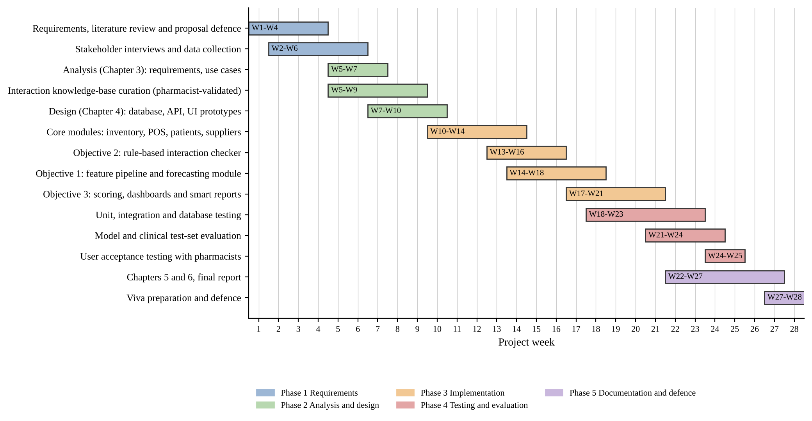

**Figure 1.1:** Gantt chart of the 28-week project plan

1.13 Organisation of the Dissertation

Chapter One introduces the study. Chapter Two reviews the literature and identifies the research gap. Chapter Three analyses the existing system and specifies the requirements of the proposed system. Chapter Four presents the design. Chapter Five will describe implementation and testing, and Chapter Six will present results, conclusions and recommendations.

1.14 Chapter Summary

This chapter positioned PharmaSense as a decision-intelligence platform for three recurring pharmacy decisions, stated the problem, aim, three objectives with measurable criteria, research questions and hypotheses, and set out the scope, tools, feasibility and plan. The next chapter reviews the literature that supports these choices and shows where the gap lies.

CHAPTER TWO: LITERATURE REVIEW

2.1 Introduction

This chapter reviews the theory and empirical evidence behind the three objectives and shows where existing work stops short of what PharmaSense sets out to do. It is organised around the three decisions introduced in Chapter One: the dispensing decision (drug interaction screening and alert design), the purchasing and stock decision (demand forecasting, expiry and inter-branch coordination), the management decision (dashboards and decision support), and the way prescriptions and products enter the system (barcode and prescription scanning). A final section brings the findings together as a research gap.

Sources were identified through targeted searches of publisher and index pages for the relevant journals and conferences (for example the Journal of the American Medical Informatics Association, the European Journal of Operational Research, the International Journal of Forecasting and Nucleic Acids Research) between September and October 2026, and each paper cited here was checked against its publisher or index record. Priority was given to peer-reviewed work that bears directly on an objective. Vendor material and news reports are used only to describe the market and the local context and are identified as such.

The review follows one idea: a gap is only credible if the authors of the existing work point to it themselves. Section 2.5 therefore records, for the core papers, where the authors stop, using their own stated limitations, conclusions and future-work statements, and Section 2.6 turns those stopping points into the research gap that PharmaSense addresses.

2.2 Theoretical and Conceptual Framework

2.2.1 Clinical decision support and alert fatigue

Clinical decision support (CDS) delivers patient-specific knowledge to a clinician at the moment of decision. Its value depends less on how much it knows than on whether its alerts are acted upon. When too many alerts are low-value, users learn to dismiss them, a phenomenon described as alert fatigue. The practical design response in the literature is tiering: reserve interruptive alerts for high-severity events and present the rest passively \[14\]. PharmaSense adopts this idea directly as a four-level severity scale (S1 contraindicated, S2 major, S3 moderate, S4 minor), where only S1 and S2 interrupt the dispenser.

2.2.2 Demand forecasting and inventory theory

Replenishment is a forecasting problem followed by an inventory decision. Forecast accuracy is judged against simple baselines, because a complex model has value only if it beats a seasonal-naive or moving-average rule. Pharmacy demand at product-branch level is often intermittent, meaning many weeks with zero or small sales, for which specialised estimators and loss functions exist \[15\]. Once a forecast and its uncertainty are available, safety stock and reorder points follow from an upper quantile of demand over the lead time. For multi-location systems, inventory theory adds lateral transshipment, the movement of stock between locations at the same level, either to rebalance in advance or to fill a shortage reactively \[16\]. For perishable goods, expiry date adds a second reason to move stock.

2.2.3 Descriptive, predictive and prescriptive decision support

Management information systems progress from descriptive reporting (what happened), to predictive analytics (what will happen), to prescriptive support (what should be done). Most pharmacy systems stop at the first. PharmaSense is designed to cover all three on one data foundation: dashboards describe, forecasts predict, and scoring turns forecasts and stock positions into ranked actions with reasons. Evidence on the effect of dashboards is encouraging but limited, as discussed in Section 2.3.4.

2.2.4 Conceptual framework

Figure 2.1 brings these ideas together. Three decisions (at the counter, the buying desk and head office) draw on one operational data foundation. Objective 2 supports the first decision, Objective 1 the second, and Objective 3 the third, and also consumes the outputs of the other two (forecasts, alert and override data). The outcomes sought are fewer unsafe dispenses, fewer stock-outs and expiry write-offs, and faster evidence-based management action.

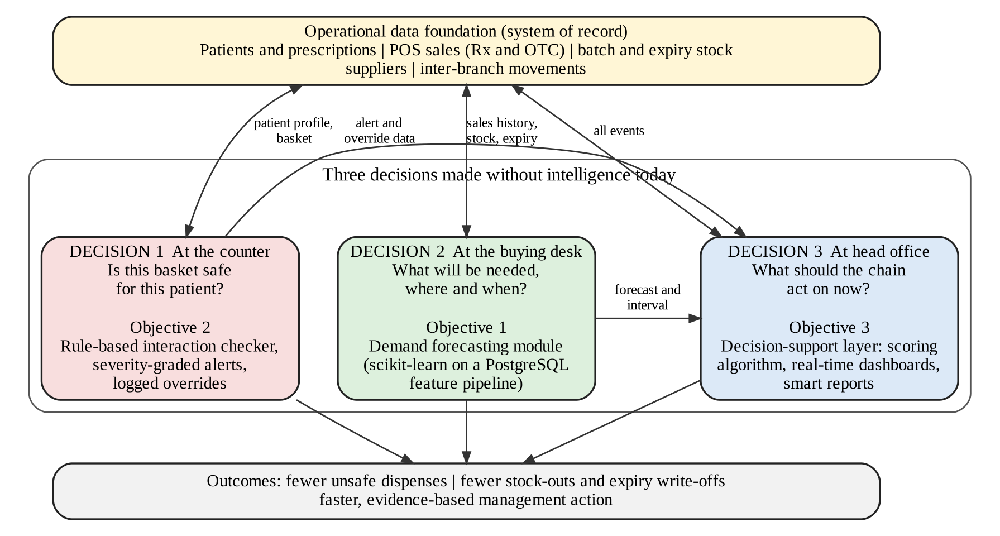

**Figure 2.1:** Conceptual framework of PharmaSense: three decisions on one data foundation

2.3 Related Work

2.3.1 Medication safety, interaction screening and alert design

The scale of the medication safety problem motivates screening \[1\], but the evidence shows that the delivery of screening is uneven. In a systematic review of 17 papers on computerised physician order entry, clinicians overrode drug safety alerts in 49% to 96% of cases \[2\]. A study of outpatient medication alerts found that about 53% were overridden and that roughly half of the overridden alerts should have been heeded \[3\]. Taken together, these results show the double risk of poorly tuned alerting: users ignore alerts, including important ones.

Two consensus studies by Phansalkar and colleagues offer a route out. The first produced a list of 15 high-severity interactions that should be alerted in every electronic record \[17\]. The second identified 33 class-based interactions of low priority that need not interrupt the workflow, citing override rates as high as 90% \[14\]. Ancker and colleagues studied alert fatigue directly in a clinical decision support system and examined the effects of workload, work complexity and repeated alerts on whether alerts are accepted \[18\]. These studies support tiering, short rationales and recorded overrides, which are the design features of Objective 2.

Pharmacy-specific evidence is less reassuring. In the Arizona field test, the median sensitivity for well-established interactions across 64 pharmacies was 0.85, but the range was 0.23 to 1.0, and only 18 of 64 pharmacies (28%) correctly identified both the interacting and the non-interacting pairs \[4\]. The knowledge itself is also inconsistent. Of 406 interactions rated major by at least one of four compendia, only 9 (2.2%) appeared in all four and 291 (71.7%) in only one, with an intraclass correlation of −0.092 among the compendia \[9\]. The implication for a rule-based checker is that coverage and severity assignment must be curated, sourced and stated openly rather than assumed. Open resources are emerging: DDInter reports about 0.24 million interaction associations among 1,833 approved drugs, each annotated with severity \[10\], which makes it a candidate starting source, subject to licence conditions and pharmacist validation.

Evidence from low-resource settings is thinner but points the same way. In a simulated-patient study of 235 community pharmacies in Khartoum, Sudan, no pharmacist asked about the patient’s current medicines, and only 13.6% and 23.4% identified the interaction in the two scripted scenarios; those who did relied about equally on their own knowledge and on interaction-checker applications on mobile phones, and the authors noted that the pharmacies had no electronic system with built-in interaction checking \[19\]. No comparable study was found for Zimbabwe, which is itself part of the gap.

Generative language models are an obvious alternative to a rule base, and the evidence argues for caution. In one study ChatGPT answered 39 of 40 questions on common interaction pairs correctly, but about half of the correct answers were inconclusive and the text was written at a university reading level \[20\]. In a French pharmacovigilance sample, three models detected interactions in 95% to 99% of cases that had one, but their specificity was only 0.36 to 0.68, because they reported interactions that did not exist \[21\]. A locally deployed model backed by a knowledge base of package inserts raised the accuracy of pharmacists’ prescription review from 82.6% to 97.2% and cut hallucinations from 19.7% to 4.7% per prescription compared with the model alone, but the sample contained no interaction errors, so that capability was not tested \[22\]. Taken together, models may assist a human reviewer when grounded in a curated knowledge base; they are not yet a safe source of truth for an interruptive S1 or S2 alert, which is why Objective 2 uses deterministic rules (Section 4.3.2).

2.3.2 Demand forecasting for pharmaceuticals and retail

Machine learning has been applied to supply-chain demand forecasting for some time; Carbonneau and colleagues compared machine-learning methods with traditional forecasting methods on supply-chain demand data \[23\]. The most informative large-scale evidence for retail unit sales comes from the M5 competition, which asked participants to forecast 42,840 hierarchical unit-sales series from Walmart; the most accurate submissions were machine-learning methods built mainly on gradient-boosted trees (LightGBM), and they outperformed the statistical benchmarks \[24\]. Gradient boosting at scale is documented in XGBoost \[25\], and a benchmark across 45 tabular datasets found that tree-based models remain state of the art on medium-sized data of about 10,000 samples \[11\]. This supports the use of scikit-learn’s histogram-based gradient boosting, which uses the same family of methods, on the tabular features that the PostgreSQL pipeline will produce.

Intermittent demand needs separate treatment. Syntetos and Boylan analysed the accuracy of intermittent-demand estimates and addressed the bias of Croston’s method \[15\], which is why a Croston-type estimator is retained as a baseline for slow-moving lines. Pharmaceutical-specific evidence is more recent and more mixed. A 2025 study using 1.2 million shipments across 39 countries compared ARIMA, ensembles and deep networks: gradient boosting performed best on pricing, ARIMA had the lowest demand-forecasting error but low explanatory power, and neural networks handled nonlinear demand shocks better; the data, however, covered antiretroviral medicines and HIV test kits in international logistics rather than retail pharmacy \[26\]. A 2026 bibliometric and systematic review of machine learning for pharmaceutical demand forecasting screened 705 Scopus records to 150 relevant publications, found long short-term memory networks, random forests, neural networks, XGBoost and linear regression to be the most used methods, and called for hybrid models, real-world data integration and more interpretable algorithms \[27\]. Interpretability can be supplied for tree models through additive explanations \[28\]; PharmaSense uses permutation importance in scikit-learn and may use SHAP values for per-forecast explanations.

Two further studies bear directly on the design. In a study of weekly sales of 57 products in eight ATC groups from a single pharmacy (about 600,000 records, 2014 to 2019), XGBoost had the lowest percentage error in four of the groups, whereas seasonal-naive, exponential-smoothing and ARIMA methods had the lowest squared error in others, and the LSTM was limited by the small dataset \[29\]. No single method won everywhere, which supports a baseline-first design in which the model is used only where it beats the baseline. On inventory, a boosting-based framework for intermittent demand gave the lowest scaled pinball loss at the 0.975 and 0.995 quantiles on M5 data, and the authors link such tail quantiles to safety-stock decisions, while noting that they did not evaluate inventory cost directly \[30\]. This supports deriving safety stock from an upper quantile forecast, as Objective 3 does.

Epidemic and seasonal signals are the reason pharmacy demand cannot be forecast from history alone. The 2018–2019 cholera outbreak in Zimbabwe produced 10,730 suspected cases over about six months, concentrated in Harare \[5\]; an outbreak flag and rainfall features are therefore included as candidate external signals in the feature pipeline.

2.3.3 Inventory, expiry and inter-branch coordination

Paterson and colleagues’ review of inventory models with lateral transshipments categorises the research and notes that transshipments can be scheduled periodically to rebalance stock in advance or used reactively to meet demand that cannot be met from stock on hand; system size, cost structure and the definition of service level determine which approach works best \[16\]. The literature is model-based; it does not describe how recommendations should be generated from live forecasts and batch expiry, approved by managers and tracked through dispatch and receipt in a pharmacy chain, which is the practical gap addressed by the scoring layer. Evidence from Ethiopia’s public supply chain points to store management as the factor most associated with expiry: of the 239,801 unit packs that expired in the sampled facilities (about 5% in the supply agency’s stores), poor store management was the only significant factor in the multivariable model \[31\]. Local reporting confirms that the problem is current: shortages and expiry write-offs occur together in the public sector, attributed largely to weak inventory records, poor forecasting and delayed redistribution \[6\].

2.3.4 Dashboards and decision support

A review of dashboards for improving patient care searched seven databases for 1996–2012 and included 11 studies out of 122 full-text papers. It concluded that there is some evidence that dashboards giving clinicians immediate access to information can improve adherence to guidelines and may help outcomes, but that the studies varied widely and that further high-quality studies and design guidelines were needed \[32\]. The review concerns clinical dashboards rather than pharmacy business intelligence, so the transfer of its findings is indirect; it nevertheless supports two design choices: put the information where the user already works, and evaluate dashboards rather than assume they help.

2.3.5 Pharmacy software and platforms

Commercial pharmacy systems from the United States, of which PioneerRx is one example, automate ordering from minimum and maximum levels that the pharmacy sets for each item, and also generate recommended orders from store operations \[7\]. That approach reacts to consumption but does not forecast a coming surge, and these systems are built around United States regulation and pricing. General enterprise resource planning platforms such as Odoo and ERPNext provide batch tracking, multi-warehouse stock and purchasing, but carry no clinical interaction knowledge unless it is built on. In Africa, mPharma reports serving more than 500 pharmacies in nine countries with a pharmacy web application, e-prescription, vendor-managed inventory and its own pharmaceutical supply chain \[8\]; this is evidence of demand for analytics-led pharmacy management in the region, but it is a vendor statement and the platform is tied to the vendor’s supply network rather than offered as software a chain can own and extend.

2.3.6 Local regulatory and data context

Dispensing in Zimbabwe is governed by the Medicines and Allied Substances Control Act \[13\], and personal data, including health data, by the Cyber and Data Protection Act \[12\]. These shape design requirements for access control, minimisation, consent and audit, which are addressed in Chapters Three and Four. Statutory details that affect specific features, such as record-keeping rules for controlled medicines, are to be confirmed with the Medicines Control Authority of Zimbabwe and the validating pharmacists during Phase 1. Infrastructure is a further local constraint: a 2025 Global Fund case study estimates that power shortages cost Zimbabwe about 6.1% of GDP a year, reports that the national electronic medical record (Impilo) is used in 1,254 facilities, and notes the adoption of the HL7 FHIR standard \[33\]. A study in The Gambia showed that a progressive web application can run offline after an initial download and work across desktop and mobile platforms from one code base \[34\], which supports the offline-tolerant design of Chapter Four.

2.3.7 Prescription capture, handwriting and barcode scanning

How a prescription or product enters the system decides how much typing, and how many typing errors, the dispenser faces. Illegible handwriting is documented in the region. In a study at a district hospital in Bloemfontein, pharmacists read sample prescriptions correctly 75% of the time against 88% for doctors, and 20% of health workers read a lorazepam dose of 4 mg as 40 mg \[35\]. In a pilot survey of South African pharmacy personnel, medicine names were identified correctly only 20% of the time and dosages 18% of the time on illegible prescriptions, and about 70% of respondents saw digital prescriptions as a probable solution \[36\]. Zimbabwe has no published national data, but a press report describes a patient who was given a diabetes medicine instead of an anti-arrhythmic after a handwritten prescription was misread \[37\]; this is used here only as local illustration.

Automatic reading of handwriting is an active research area, and its results show why it can assist but not decide. A pipeline using Mask R-CNN for segmentation and the TrOCR recogniser \[38\], trained on about 1,000 handwritten prescriptions from 50 doctors in Pakistan, reached a character error rate of 1.4% on its validation split, but about 13.5% on a small test set of 47 images after matching against a medicine database \[39\]. On a large simulated dataset of Indian prescriptions, general-purpose vision-language models without fine-tuning scored only about 2% to 8% F1, a fine-tuned model reached 82% on medicine name and dosage, accuracy fell for rarer medicines, and the authors state that the model should not be deployed \[40\]. Both studies use data from other countries, and neither includes a pharmacist confirmation step. The implication for design is that recognised text must be treated as a draft: matched to the local product catalogue, scored for confidence, and confirmed line by line by a pharmacist.

Barcode scanning is the deterministic counterpart. In a before-and-after study in a hospital pharmacy, bar-code-assisted dispensing reduced dispensing errors and potential adverse drug events when each dose was scanned, but potential events increased when only one dose per batch was scanned \[41\], so the scan must be required, not optional, for the benefit to hold. A study of 28 pharmacy staff ranked resistance to change as the top barrier to adopting a barcode system \[42\], which argues for a workflow that is faster than typing. GS1 DataMatrix, a two-dimensional code used in healthcare, can carry the product code, expiry date, batch number and serial number in one symbol but must be read by a camera-based scanner and not a laser scanner \[43\]. For a pharmacy that manages stock by batch and expiry, such a code would remove the need to type both. How many medicines on the Zimbabwean market carry a DataMatrix code is not established and will be checked in Phase 1; the design therefore falls back to linear barcodes and manual entry.

2.4 Summary of Reviewed Studies

**Table 2.1:** Summary of the principal studies reviewed

| **Study**                                            | **Focus and setting**                                               | **Key finding (as reported)**                                                          | **Relevance and limit for PharmaSense**                        |
|------------------------------------------------------|---------------------------------------------------------------------|----------------------------------------------------------------------------------------|----------------------------------------------------------------|
| van der Sijs et al., 2006 \[2\]                      | Review of 17 papers on alert overriding in computerised order entry | Alerts overridden in 49–96% of cases                                                   | Motivates tiered alerts; hospital setting                      |
| Nanji et al., 2014 \[3\]                             | Outpatient medication alerts                                        | ~53% overridden; about half of overrides should have been heeded                       | Shows risk of ignored alerts; prescriber-side setting          |
| Phansalkar et al., 2012 \[17\]                       | Expert consensus                                                    | 15 high-severity interactions for all EHRs                                             | Seed list for S1/S2 rules; US drug supply                      |
| Phansalkar et al., 2013 \[14\]                       | Expert consensus                                                    | 33 class-based low-priority interactions suitable for non-interruptive display         | Basis for passive S3/S4 tier; US drug supply                   |
| Ancker et al., 2017 \[18\]                           | Alert fatigue in a CDS system                                       | Effect of workload, complexity and repeated alerts on alert acceptance                 | Supports alert-burden measures; not pharmacy retail            |
| Saverno et al., 2011 \[4\]                           | Field test of 64 community pharmacies                               | Only 18 of 64 (28%) fully correct; sensitivity 0.23–1.0                                | Direct pharmacy evidence; one US state                         |
| Abarca et al., 2004 \[9\]                            | Four interaction compendia                                          | Only 2.2% of major interactions in all four                                            | Justifies curated, sourced rules; older data                   |
| Xiong et al., 2022 \[10\]                            | DDInter database                                                    | ~0.24 million interactions, 1,833 drugs, with severity                                 | Candidate open source; licence and local coverage to verify    |
| Carbonneau et al., 2008 \[23\]                       | ML for supply-chain demand                                          | ML methods compared with traditional methods                                           | Early ML evidence; not pharmacy                                |
| Makridakis et al., 2022 \[24\]                       | M5 retail forecasting, 42,840 series                                | Best methods were gradient-boosted tree ML; beat benchmarks                            | Supports tree ensembles; large-retailer data                   |
| Park et al., 2025 \[26\]                             | Pharma logistics, 1.2M shipments                                    | Mixed: boosting best on price; ARIMA lowest demand error; NN for shocks                | Pharma-specific; ARV and international shipments               |
| Ramadhan et al., 2026 \[27\]                         | Review of 150 ML pharma-demand papers                               | Growth in LSTM, RF, XGBoost; need interpretability and real data                       | Confirms gap; narrative synthesis                              |
| Paterson et al., 2011 \[16\]                         | Review of lateral transshipment models                              | Rebalancing in advance or reactive transshipment                                       | Theory for transfers; not workflow                             |
| Dowding et al., 2015 \[32\]                          | Review of dashboards, 11 studies                                    | Some evidence of benefit; more research needed                                         | Indirect; clinical rather than business dashboards             |
| Hamadouk et al., 2022 \[19\]                         | 235 community pharmacies, Khartoum, simulated patients              | No history taken; interaction identified in 13.6% and 23.4% of visits                  | Low-resource pharmacy evidence; Sudan, not Zimbabwe            |
| Juhi et al., 2023 \[20\]; Sicard et al., 2025 \[21\] | ChatGPT and other models on interactions                            | 39/40 correct but often inconclusive; specificity 0.36–0.68 in case reports            | Argues against models as source of truth for alerts            |
| Liu et al., 2026 \[22\]                              | Local LLM with package-insert knowledge base, 213 prescriptions     | Pharmacist accuracy 82.6% to 97.2% with AI; hallucination 19.7% to 4.7% with knowledge | Model as assistant to a human; no interaction errors in sample |
| Fourkiotis and Tsadiras, 2024 \[29\]                 | One pharmacy, 57 products, weekly sales                             | XGBoost lowest MAPE in 4 of 8 groups; classical methods won others                     | Pharmacy data, single site; supports baselines                 |
| Li et al., 2022 \[30\]                               | Intermittent demand, M5 and RAF data                                | Boosting-based combinations best at high quantiles                                     | Links quantiles to safety stock; no cost evaluation            |
| Brits et al., 2017 \[35\]; Modi et al., 2022 \[36\]  | Illegible prescriptions, South Africa                               | Pharmacists 75% correct; names 20% and doses 18% correct on illegible set              | Regional evidence of the input problem                         |
| Ali et al., 2024 \[39\]; Mankash et al., 2024 \[40\] | Handwritten prescription recognition (Pakistan; simulated India)    | Test error 13.5%; general models 2–8% F1; fine-tuned 82%                               | Preprints; other countries; not deployable as autonomous       |
| Poon et al., 2006 \[41\]                             | Bar code dispensing, hospital pharmacy                              | Fewer dispensing errors when each dose scanned                                         | Supports mandatory barcode scan; hospital setting              |

2.5 Where the Literature Stops

Table 2.2 lists the core papers for each objective and, for each, the point at which the authors themselves stop: a limitation they state, a gap they name, or work they leave for the future. The statements are taken from the authors’ own limitations, conclusions or future-work text, as read on the publisher or repository page of each paper in October 2026, and are paraphrased unless quoted. Figure 2.2 summarises the pattern. The right-hand column of the table is what this project adds. It is a design response, not a claim that the work will fix the whole problem. Three of the papers in the table (Li et al., Ali et al. and Mankash et al.) are arXiv preprints that have not been through journal peer review, so they are used for what they report and not as settled evidence.

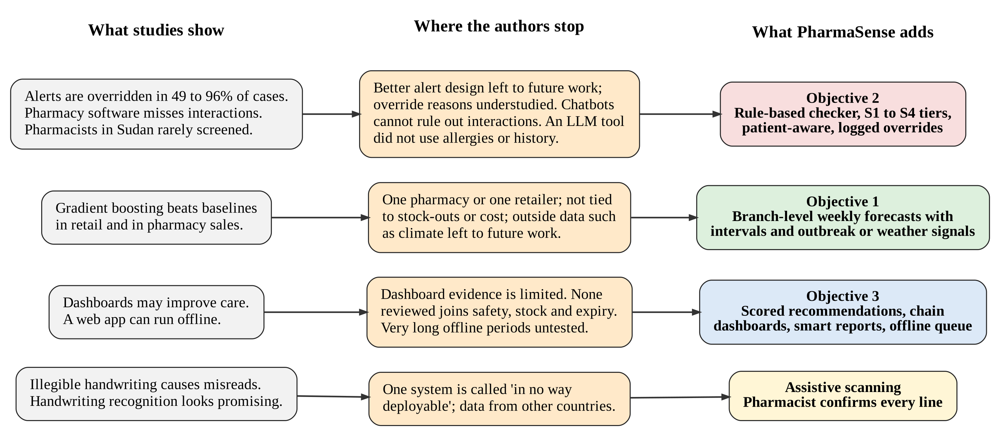

**Figure 2.2:** From what the studies show, to where the authors stop, to what PharmaSense adds

**Table 2.2:** Where the core papers stop, and what PharmaSense adds

| **Study**                                    | **Where the authors stop**                                                                                                                                                                                                                                                                                | **What PharmaSense adds**                                                                                                                                |
|----------------------------------------------|-----------------------------------------------------------------------------------------------------------------------------------------------------------------------------------------------------------------------------------------------------------------------------------------------------------|----------------------------------------------------------------------------------------------------------------------------------------------------------|
| **Objective 2: dispensing safety**           |                                                                                                                                                                                                                                                                                                           |                                                                                                                                                          |
| van der Sijs et al., 2006 \[2\]              | Alerts were overridden in 49–96% of cases. The authors say a distinction between appropriate and useful alerts should be made, and that studies of why alerts are overridden are lacking.                                                                                                                 | S1–S4 tiers so that only serious alerts interrupt; a reason code stored at every override.                                                               |
| Nanji et al., 2014 \[3\]                     | About half of outpatient medication alerts were overridden, and about half of those overrides were judged inappropriate. The authors call for clinical decision support that reduces inappropriate alerts.                                                                                                | Overrides saved with severity, reason and user so they can be reviewed later.                                                                            |
| Ancker et al., 2017 \[18\]                   | The study had no severity data for alerts and no manual review of whether overrides were appropriate. The authors suggest reducing repeats of the same alert.                                                                                                                                             | Severity stored with each alert; a pharmacist-reviewed override log.                                                                                     |
| Saverno et al., 2011 \[4\]                   | Only 18 of 64 pharmacies (28%) handled the tested interacting and non-interacting pairs correctly. The authors call for comprehensive improvement of how pharmacy systems identify interactions.                                                                                                          | A curated, sourced rule base, tested on a pharmacist-built set with sensitivity and specificity reported.                                                |
| Hamadouk et al., 2022 \[19\]                 | In Khartoum, 13.6% and 23.4% of pharmacies identified the interaction in the two scenarios, and none asked about current medicines. The authors urge software in community pharmacies, but tested only two drug pairs and did not study pharmacy operations.                                              | Screening built into the sale for prescription and over-the-counter items, with the patient’s medicines asked for at the counter.                        |
| Juhi et al., 2023 \[20\]                     | ChatGPT answered 39 of 40 drug pairs correctly, but about half the answers were inconclusive. The authors say its ability to predict and explain interactions needs further improvement.                                                                                                                  | Deterministic rules with a source for every alert; no generated text decides an alert.                                                                   |
| Sicard et al., 2025 \[21\]                   | Language models found most interaction cases but could not reliably exclude interactions where none existed (specificity 0.36–0.68). The authors suggest testing prompts and building small specialist models.                                                                                            | Rule matching that returns nothing when no rule applies, so a missing alert can be explained.                                                            |
| Liu et al., 2026 \[22\]                      | A local language model with a knowledge base raised accuracy from 82.6% to 97.2%, but reviewed each prescription alone, without allergies or medication history, and the sample had no confirmed interaction errors. Future work: integrate history and learn from pharmacist accept or reject decisions. | Screening uses the patient’s allergies, conditions and medicines; the override log is the record of pharmacist decisions that later work can learn from. |
| **Objective 1: demand forecasting**          |                                                                                                                                                                                                                                                                                                           |                                                                                                                                                          |
| Fourkiotis and Tsadiras, 2024 \[29\]         | Data came from one pharmacy and the authors say it limited the neural network. They propose more algorithms and outside data such as climate or demographics.                                                                                                                                             | Many branches, weekly horizon, and external weather and outbreak features in the feature pipeline.                                                       |
| Li et al., 2022 \[30\]                       | The authors note the lack of a comprehensive evaluation of inventory performance, and leave it for future research.                                                                                                                                                                                       | Forecasts evaluated against stock-outs and expiry, not accuracy alone, with an upper quantile for ordering.                                              |
| Makridakis et al., 2022 \[24\]               | One retail data set; accuracy was not tied to costs; the authors call for checks in other areas and note that managers need to understand how models use price, promotions and events.                                                                                                                    | A pharmacy-specific data set, simple baselines, and a stated reason for each recommendation.                                                             |
| Park et al., 2025 \[26\]                     | The authors state that empirical validation of predictive models in pharmaceutical supply chains is lacking, and that deep models struggled with volatile demand.                                                                                                                                         | A branch-level evaluation reported against seasonal and intermittent-demand baselines.                                                                   |
| **Objective 3: decision support**            |                                                                                                                                                                                                                                                                                                           |                                                                                                                                                          |
| Dowding et al., 2015 \[32\]                  | Only 11 of 122 full-text papers qualified, and the evidence was limited. The authors call for further high-quality studies and guidelines for dashboard design.                                                                                                                                           | Chain dashboards tested with tasks and a usability score, linked to actions.                                                                             |
| Mohammed et al., 2021 \[34\]                 | A progressive web app ran offline, but the authors warn that very long offline periods could have unpredictable effects and note limits on iOS.                                                                                                                                                           | An offline queue that is tested against a planned power and network outage.                                                                              |
| **Input: prescription and product scanning** |                                                                                                                                                                                                                                                                                                           |                                                                                                                                                          |
| Brits et al., 2017 \[35\]                    | Pharmacists read 75% of items correctly, and 20% of staff read lorazepam 4 mg as 40 mg. The authors conclude a digital pen is not a solution and ask doctors to avoid abbreviations.                                                                                                                      | Barcode and DataMatrix capture as the deterministic path; prescription images only as assistance.                                                        |
| Modi et al., 2022 \[36\]                     | All 59 participants made errors reading illegible prescriptions. The authors note the small sample, mostly trainees, and favour digital prescriptions.                                                                                                                                                    | The dispenser confirms or corrects every line before screening.                                                                                          |
| Ali et al., 2024 \[39\]                      | A recogniser reported 1.4% character error on benchmark data, but an error of about 13.5% on a small test set. The authors do not report a deployment study.                                                                                                                                              | Confidence scores with a fixed threshold; low-confidence lines go to manual entry.                                                                       |
| Mankash et al., 2024 \[40\]                  | The authors say their accuracy is “in no way deployable and should not be deployed”, and that rare drugs were handled poorly on simulated data.                                                                                                                                                           | Human confirmation of every line; a catalogue match rather than free-text trust.                                                                         |

2.6 Research Gap

From the stopping points in Table 2.2 and the wider review, six gaps emerge. They are stated cautiously: they describe what was found, or not found, in the sources examined, and not everything that exists in commercial products. Table 2.3 maps each gap to the objective that addresses it.

**Table 2.3:** Research gaps and how PharmaSense responds

| **\#** | **Gap in the reviewed evidence**                                                                                                                                                                                                                                                                                                                                                                                 | **How PharmaSense responds**                                                                                                                                                           | **Objective** |
|--------|------------------------------------------------------------------------------------------------------------------------------------------------------------------------------------------------------------------------------------------------------------------------------------------------------------------------------------------------------------------------------------------------------------------|----------------------------------------------------------------------------------------------------------------------------------------------------------------------------------------|---------------|
| G1     | Screening evidence is mostly from hospital or ambulatory prescribing; pharmacy software performance varies widely \[4\]; severity ratings differ between sources \[9\]; and a study from Sudan found that pharmacists rarely asked about current medicines \[19\]. No open, locally validated rule base was found for Zimbabwean retail pharmacy that also screens over-the-counter sales and records overrides. | Curated, sourced and pharmacist-validated rules; every basket screened, Rx and OTC; S1–S4 tiering; logged overrides; coverage limits stated.                                           | 2             |
| G2     | Forecasting evidence is strong for general retail \[24\] and growing for pharma \[26\], \[27\], but reviews call for real-world data integration and interpretability, and pharma studies reviewed are not branch-level retail with outbreak signals.                                                                                                                                                            | Branch-level weekly forecasts with prediction intervals, outbreak and weather features, baselines and explanations, built on a SQL feature pipeline.                                   | 1             |
| G3     | Transshipment research is model-based \[16\]; the reviewed commercial example reorders from fixed levels \[7\]. Forecast- and expiry-aware, tracked transfer recommendations were not found in the sources reviewed.                                                                                                                                                                                             | Scoring layer that combines stock-out risk, expiry risk, benefit and cost to rank transfers and orders, with approval and tracking.                                                    | 3             |
| G4     | Dashboard evidence is limited and clinical \[32\]; chain-level views that join safety events with stock and expiry were not found.                                                                                                                                                                                                                                                                               | Real-time chain dashboards and smart reports that explain changes and link to actions.                                                                                                 | 3             |
| G6     | Illegible prescriptions and manual entry are documented in the region \[35\], \[36\]; handwriting recognition is promising but unreliable and comes from other countries \[39\], \[40\]. No work was found that joins barcode, DataMatrix and prescription-image capture to interaction screening and batch capture, with pharmacist confirmation, in a retail pharmacy in Zimbabwe.                             | Scan-assisted capture as an input channel to the dispensing flow: deterministic barcode path, assistive OCR, confidence thresholds, mandatory line-by-line confirmation, logged edits. | 2 (input)     |
| G5     | Decisions are treated in isolation, and accuracy of forecasts and alerts is rarely reported against baselines in an open way.                                                                                                                                                                                                                                                                                    | One data foundation for all three decisions; evaluation against baselines and a pharmacist-built test set, with results reported.                                                      | 1, 2, 3       |

2.7 Chapter Conclusion

The literature supports five design decisions: tier interaction alerts and record overrides; use tree-based machine learning with baselines, intervals and explanations for demand; treat inter-branch transfers as a scored, approved and tracked process; evaluate dashboards instead of assuming they help; and treat scanning as an assistive input that a pharmacist confirms. It also shows that the combination of these in one pharmacy-chain platform, built for a Zimbabwean setting and evaluated against baselines, has not been reported in the sources reviewed. Chapter Three now analyses the existing system and specifies what the proposed system must do.

CHAPTER THREE: ANALYSIS

3.1 Introduction

This chapter describes how the three decisions are made today, analyses the existing system with UML context and data flow diagrams, evaluates alternative solutions, and specifies the functional and non-functional requirements of PharmaSense with use case diagrams. The existing-system description is built from the problem analysis in Chapter One and the literature in Chapter Two, and it will be confirmed and refined by the fieldwork described in Section 3.2.

3.2 Information Gathering Tools

Six fact-finding methods were chosen so that each answer can be checked from a second angle (Table 3.1). The instruments are in Appendix A.

**Table 3.1:** Information gathering tools

| **Tool**                   | **Purpose**                                                                                                                            | **Respondents or source**                                                        | **Planned size**                          |
|----------------------------|----------------------------------------------------------------------------------------------------------------------------------------|----------------------------------------------------------------------------------|-------------------------------------------|
| Semi-structured interviews | Dispensing workflow, interaction checking in practice, alert and override behaviour, purchasing and transfer practice, reporting needs | Pharmacists, pharmacy technicians, branch managers, buyers, head-office managers | 8–12 interviews across 3 or more branches |
| Questionnaire              | Counter workload, use of references, frequency of stock-outs and expiry, willingness to use alerts                                     | Dispensers and cashiers                                                          | 30–40 responses                           |
| Direct observation         | Time taken per dispensing transaction, interruptions, informal checks                                                                  | Counters at 2–3 branches                                                         | Two half-days per branch                  |
| Document review            | Stock cards, order books, month-end reports, transfer notes, price lists                                                               | Branch and head-office files                                                     | One month per branch                      |
| Secondary data             | Sales history for forecasting; outbreak bulletins and rainfall for external signals                                                    | Partner chain extract; public bulletins                                          | At least 18 months, anonymised            |
| Expert validation panel    | Validate interaction rules and the 250-scenario test set                                                                               | Two registered pharmacists                                                       | Three review sessions                     |

All fieldwork will follow informed consent and anonymisation: no patient identifiers are collected for research, sales extracts are anonymised before they leave the pharmacy, and the processing of any personal data follows the Cyber and Data Protection Act \[12\]. Institutional approval will be obtained from HIT before data collection begins.

> Status of fieldwork: data collection is scheduled for Phase 1 (Weeks 2–6). Sections 3.3 and 3.4 therefore describe the existing system as derived from the problem analysis and published evidence, and are marked for validation. Findings from interviews and observation will be added to Table 3.2 and used to confirm or correct the data flow diagrams.

3.3 Description of the Existing System

In a typical retail pharmacy chain in Harare, the five activities below are carried out with different tools that do not share data.

- **Dispensing and sales.** A patient or customer presents a written prescription or asks for an over-the-counter product. A dispenser or pharmacist checks the prescription, picks the medicine and records the sale in a standalone point-of-sale program or a register. Interactions, allergies and conditions are checked from memory or by reference to a book or a phone application, if at all. Over-the-counter sales usually bypass clinical review.

- **Stock control.** Stock is tracked by product on cards or spreadsheets. Batch numbers and expiry dates are not held in a form that supports first-expiry-first-out, so near-expiry stock is found late and manual stocktakes leave recorded and physical stock out of line.

- **Purchasing.** The buyer orders from suppliers by phone, email or messaging, using experience and last month’s orders. There is no per-branch forecast and no systematic allowance for outbreaks or seasons.

- **Inter-branch movement.** When one branch has run out and another holds surplus, managers arrange a transfer by phone, and the movement is recorded on paper if at all.

- **Management reporting.** Head office receives sales and stock summaries after month-end, by branch, as static documents.

**Table 3.2:** Problems in the existing system and the objective that addresses each

| **\#** | **Problem**                                                                                                             | **Consequence**                                              | **Addressed by**          |
|--------|-------------------------------------------------------------------------------------------------------------------------|--------------------------------------------------------------|---------------------------|
| P1     | No automatic check of the basket against current medicines, allergies and conditions; OTC sales outside clinical review | Harmful combinations rely on pharmacist memory and workload  | Objective 2               |
| P2     | No severity grading, so all warnings (where they exist) look alike                                                      | Alert fatigue; important warnings ignored \[2\]              | Objective 2               |
| P3     | Stock tracked by product, not by batch and expiry; no FEFO                                                              | Late discovery of near-expiry stock; write-offs              | Core, Objective 3         |
| P4     | Purchasing from experience and last month’s orders                                                                      | Stock-outs on fast lines, overstock on slow lines            | Objective 1               |
| P5     | No seasonal or outbreak anticipation                                                                                    | Shortages during surges                                      | Objective 1               |
| P6     | Informal, untracked transfers between branches                                                                          | Reordering from suppliers while another branch holds surplus | Objective 3               |
| P7     | Static, month-end, single-branch reports                                                                                | Head office cannot see live chain position                   | Objective 3               |
| P8     | Overrides and safety events not recorded                                                                                | No audit or learning from overrides                          | Objective 2               |
| P9     | Handwritten prescriptions are misread and product, batch and expiry are typed by hand \[35\], \[36\]                    | Dispensing errors; slow, error-prone entry                   | Objective 2 (input), Core |

3.4 Data Analysis of the Existing System

Figure 3.1 is the context diagram of the existing system. It shows the single system boundary, the external entities and the data crossing the boundary. Figure 3.2 decomposes the system into five processes and four data stores. The stores are separate and unconnected, which is the structural cause of problems P3 to P7: sales are recorded in the POS database (D2), stock in cards and spreadsheets (D3), and orders in a supplier order book (D4), with no automatic link between them.

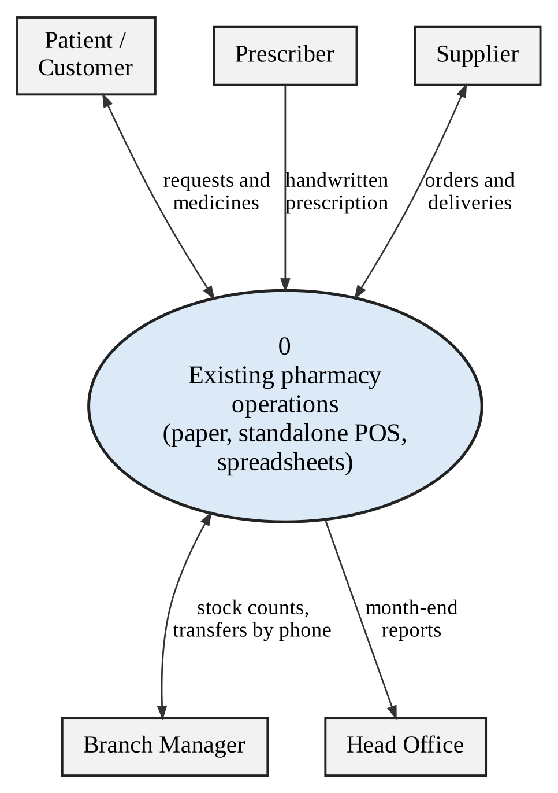

**Figure 3.1:** Context diagram of the existing system

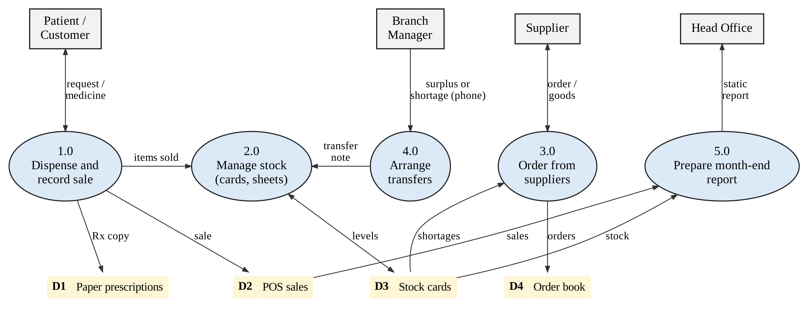

**Figure 3.2:** Level 0 data flow diagram of the existing system

3.5 Evaluation of Alternative Systems

Five options were evaluated: A0, continue as at present; A1, an international commercial pharmacy system of the PioneerRx type; A2, a general ERP platform (Odoo or ERPNext) customised for pharmacy; A3, a regional pharmacy platform such as mPharma; and A4, PharmaSense. Table 3.3 scores each against seven criteria weighted by importance to the problem in Section 1.3. Scores run from 1 (poor) to 5 (strong) and are the analyst’s judgement from the capabilities described in Section 2.3.5 and general knowledge of each class of product. The scores for A4 are design targets, not measured results, and the exercise will be repeated with measured results in Chapter Five.

**Table 3.3:** Weighted evaluation of alternative systems (1 = poor, 5 = strong)

| **Criterion**                                   | **Weight** | **A0 Status quo** | **A1 Intl. commercial** | **A2 ERP** | **A3 Regional platform** | **A4 PharmaSense** |
|-------------------------------------------------|------------|-------------------|-------------------------|------------|--------------------------|--------------------|
| Interaction screening, Rx and OTC               | 20         | 1                 | 4                       | 1          | 3                        | 4                  |
| Batch and expiry control                        | 10         | 1                 | 4                       | 5          | 4                        | 4                  |
| Demand forecasting and predictive replenishment | 20         | 1                 | 2                       | 3          | 4                        | 4                  |
| Inter-branch coordination                       | 10         | 1                 | 2                       | 4          | 3                        | 4                  |
| Chain-wide dashboards and reports               | 10         | 1                 | 3                       | 4          | 3                        | 4                  |
| Local fit: cost, currency, offline, regulation  | 20         | 2                 | 2                       | 3          | 3                        | 5                  |
| Ownership and extensibility                     | 10         | 1                 | 2                       | 4          | 1                        | 5                  |
| Weighted total (out of 100)                     | 100        | 24                | 54                      | 62         | 62                       | 86                 |

The ranking reflects the reasoning that follows. International commercial systems are strong on dispensing workflow and batch control but are built around foreign regulation and priced in foreign currency, and they replenish from fixed levels \[7\]. An ERP gives strong batch, multi-warehouse and reporting capability but no clinical knowledge, and the interaction checker would have to be built on it anyway. A regional platform shows the value of analytics but is tied to the vendor’s supply network \[8\]. Building PharmaSense gives the best fit to the three decisions and full ownership, at the cost of development effort and the burden of curating clinical knowledge. That cost is accepted because it is also the source of the research contribution.

3.6 Functional Analysis of the Proposed System

3.6.1 System overview and actors

PharmaSense is a web-based multi-branch system with two parts: an operational core that records daily work, and an intelligence layer made of the three objectives. The context diagram and the data flow diagrams of the proposed system are in Chapter Four. Table 3.4 lists the actors.

**Table 3.4:** Actors of the proposed system

| **Actor**             | **Role in the system**                                                             | **Main use cases**       |
|-----------------------|------------------------------------------------------------------------------------|--------------------------|
| Dispenser / Cashier   | Operates the point of sale; identifies the patient; scans items                    | UC01, 02, 04, 05, 08, 09 |
| Pharmacist            | Reviews alerts, overrides with reason, records allergies and conditions            | UC03, 04, 07             |
| Branch Manager        | Receives goods, runs stocktakes, requests and approves transfers, approves returns | UC10, 12–14, 18, 19, 20  |
| Procurement Officer   | Reviews forecasts and suggested orders; manages suppliers and products             | UC11, 15–17              |
| Head Office Executive | Views chain dashboards and receives smart reports                                  | UC20, 21                 |
| System Administrator  | Manages users, roles, interaction rules and the audit trail                        | UC22–24                  |
| Supplier (external)   | Receives purchase orders; delivers goods; supplies price lists                     | UC12, 16                 |

3.6.2 Functional requirements

Table 3.5 lists the functional requirements. Priority follows the MoSCoW scale: M (must), S (should), C (could). “Core” means the operational foundation needed by the objectives.

**Table 3.5:** Functional requirements

| **ID** | **Requirement**                                                                                                                                                                      | **Objective** | **Priority** |
|--------|--------------------------------------------------------------------------------------------------------------------------------------------------------------------------------------|---------------|--------------|
| FR-01  | Authenticate users and enforce role-based access for seven roles.                                                                                                                    | Core          | M            |
| FR-02  | Manage branches, users and roles.                                                                                                                                                    | Core          | M            |
| FR-03  | Maintain a product master with active ingredients and ATC class for every product.                                                                                                   | Core          | M            |
| FR-04  | Record each received batch with batch number and expiry date, per branch.                                                                                                            | Core          | M            |
| FR-05  | Allocate stock first-expiry-first-out (FEFO) when a sale is completed.                                                                                                               | Core          | M            |
| FR-06  | Record patients with allergies, chronic conditions and current medicines, with consent.                                                                                              | Core          | M            |
| FR-07  | Process prescription and OTC sales in one flow; link Rx sales to a patient and OTC sales to an optional patient.                                                                     | Core          | M            |
| FR-08  | Issue receipts; process returns and voids with manager approval.                                                                                                                     | Core          | S            |
| FR-09  | Manage suppliers, price lists, purchase orders and goods-received notes.                                                                                                             | Core          | M            |
| FR-10  | Run full and cycle stocktakes, flag variances and post approved adjustments with an audit trail.                                                                                     | Core          | S            |
| FR-11  | Raise low-stock and near-expiry alerts per branch.                                                                                                                                   | Core          | M            |
| FR-12  | Screen every basket before completion against pair, allergy and condition rules, using resolved ingredients and classes.                                                             | Obj. 2        | M            |
| FR-13  | Grade every alert S1–S4 and show mechanism, rationale and management advice.                                                                                                         | Obj. 2        | M            |
| FR-14  | Interrupt the dispenser for S1 and S2; show S3 and S4 as passive notices.                                                                                                            | Obj. 2        | M            |
| FR-15  | Require a reason code and authentication to override S1 or S2; log user, time, rule and reason.                                                                                      | Obj. 2        | M            |
| FR-16  | Maintain the interaction knowledge base: add, edit and retire rules with source, validator and version history.                                                                      | Obj. 2        | M            |
| FR-17  | Keep screening available offline from a cached rule set and reconcile on reconnection.                                                                                               | Obj. 2        | S            |
| FR-18  | Report alert and override statistics by severity, branch and user.                                                                                                                   | Obj. 2        | S            |
| FR-19  | Build a weekly feature table per product and branch from sales, stock, calendar and external signals using SQL.                                                                      | Obj. 1        | M            |
| FR-20  | Train and evaluate models with time-ordered validation against baselines; store the metrics.                                                                                         | Obj. 1        | M            |
| FR-21  | Produce weekly forecasts with a median and an upper quantile for each product and branch.                                                                                            | Obj. 1        | M            |
| FR-22  | Explain forecasts through feature importance.                                                                                                                                        | Obj. 1        | S            |
| FR-23  | Run forecasting on a schedule; fall back to a baseline when the model does not beat it.                                                                                              | Obj. 1        | M            |
| FR-24  | Import external signals (outbreak flags, rainfall) by file upload or manual entry.                                                                                                   | Obj. 1        | S            |
| FR-25  | Compute safety stock, reorder point and a suggested order quantity from the forecast.                                                                                                | Obj. 3        | M            |
| FR-26  | Score and rank suppliers on fill rate, on-time delivery and price.                                                                                                                   | Obj. 3        | S            |
| FR-27  | Recommend inter-branch transfers with a score and the reasons behind it.                                                                                                             | Obj. 3        | M            |
| FR-28  | Support the transfer workflow: request, approve, dispatch, receive and record variance.                                                                                              | Obj. 3        | M            |
| FR-29  | Provide real-time dashboards (sales, stock health, expiry exposure, stock-outs, transfers, supplier performance, safety events) by branch or chain.                                  | Obj. 3        | M            |
| FR-30  | Generate scheduled smart reports with a plain-language summary of changes and actions; export PDF and CSV.                                                                           | Obj. 3        | M            |
| FR-31  | Allow drill-down from a dashboard indicator to the underlying transactions.                                                                                                          | Obj. 3        | C            |
| FR-32  | Keep an audit trail of changes to critical records, viewable by the administrator.                                                                                                   | All           | M            |
| FR-33  | Read linear barcodes and GS1 DataMatrix codes with a camera or scanner to select a product and, where encoded, capture batch number and expiry date at receiving and at the counter. | Core          | S            |
| FR-34  | Capture a prescription image by camera or upload and produce draft lines (drug, strength, form, dose, quantity) matched to the product catalogue, each with a confidence score.      | Obj. 2        | S            |
| FR-35  | Add scanned lines to the basket only after a pharmacist confirms each line; lines below the confidence threshold require manual product selection; every correction is logged.       | Obj. 2        | S            |

3.6.3 Non-functional requirements

**Table 3.6:** Non-functional requirements

| **ID** | **Category**           | **Requirement and measure**                                                                                                                                                                                                                |
|--------|------------------------|--------------------------------------------------------------------------------------------------------------------------------------------------------------------------------------------------------------------------------------------|
| NFR-01 | Performance            | Interaction screening returns in 1 second or less at the 95th percentile for baskets of up to 10 items.                                                                                                                                    |
| NFR-02 | Performance            | A completed sale is visible in dashboard KPIs within 5 seconds (95th percentile); pages load within 3 seconds on a 4G connection.                                                                                                          |
| NFR-03 | Capacity               | Supports at least 10 branches, 50 concurrent users, 5,000 products and 3 million sale lines a year.                                                                                                                                        |
| NFR-04 | Availability           | Server availability of at least 99% a month; point of sale continues during server or network outage.                                                                                                                                      |
| NFR-05 | Offline tolerance      | Dispensing with interaction screening works for at least 8 hours offline and synchronises without data loss.                                                                                                                               |
| NFR-06 | Security               | TLS 1.2 or higher; passwords stored with a salted slow hash; least-privilege roles; session time-out; no high-severity findings in an OWASP ZAP scan.                                                                                      |
| NFR-07 | Privacy and compliance | Data minimisation; consent flag; national ID stored only as a salted hash; design aligned to the Cyber and Data Protection Act \[12\].                                                                                                     |
| NFR-08 | Integrity and audit    | Audit and override tables are append-only for application accounts; no update or delete privilege.                                                                                                                                         |
| NFR-09 | Usability              | System Usability Scale score of at least 70; a new dispenser can complete a sale after two hours of training.                                                                                                                              |
| NFR-10 | Explainability         | Every alert, forecast and recommendation displays its reason in plain language.                                                                                                                                                            |
| NFR-11 | Maintainability        | Modular services with at least 70% unit-test coverage of service code; OpenAPI documentation generated from the code.                                                                                                                      |
| NFR-12 | Portability            | Runs in containers on Ubuntu LTS; supported on current Chrome, Edge and Firefox.                                                                                                                                                           |
| NFR-13 | Backup and recovery    | Encrypted nightly off-site backup; recovery point 24 hours; recovery time 4 hours.                                                                                                                                                         |
| NFR-14 | Localisation           | Prices and reports in USD and local currency; local formulary names searchable.                                                                                                                                                            |
| NFR-15 | Image privacy          | Prescription images are processed on the pharmacy’s own server or device, encrypted at rest, kept only as long as the retention rule requires (to be confirmed with the Medicines Control Authority) and not sent to third-party services. |

3.6.4 Use case diagrams

The use cases are grouped into three diagrams: dispensing and patient safety (Figure 3.3), inventory, procurement and transfers (Figure 3.4), and management intelligence and administration (Figure 3.5).

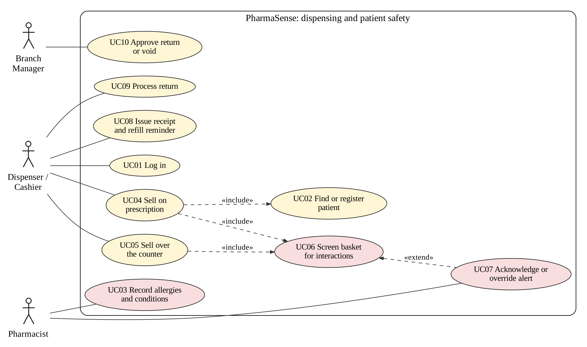

**Figure 3.3:** Use case diagram: dispensing and patient safety

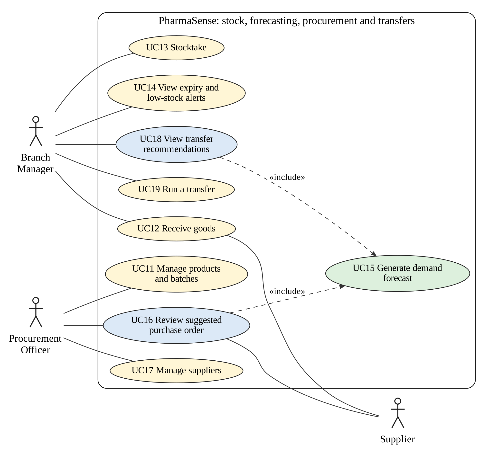

**Figure 3.4:** Use case diagram: inventory, procurement and transfers

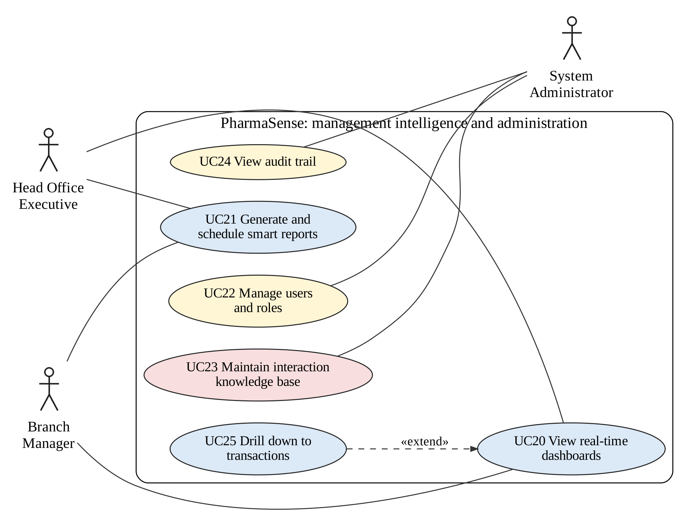

**Figure 3.5:** Use case diagram: management intelligence and administration

3.6.5 Use case specifications

Table 3.7 to Table 3.9 specify the three use cases that carry the objectives.

**Table 3.7:** Use case specification: dispense with interaction screening (UC04, UC05, UC06, UC07)

<table>
<colgroup>
<col style="width: 20%" />
<col style="width: 79%" />
</colgroup>
<thead>
<tr class="header">
<th><strong>Item</strong></th>
<th><strong>Description</strong></th>
</tr>
</thead>
<tbody>
<tr class="odd">
<td>Actors</td>
<td>Dispenser / Cashier (primary); Pharmacist (for override).</td>
</tr>
<tr class="even">
<td>Precondition</td>
<td>User is logged in; branch has stock; interaction rules are loaded (online or cached).</td>
</tr>
<tr class="odd">
<td>Main flow</td>
<td>
1. Dispenser identifies the patient (or proceeds as anonymous OTC).

2. Dispenser scans or selects items.

3. System resolves each item to active ingredients and classes and screens the basket against pair, allergy and condition rules using the patient profile.

4. System shows no alert, or passive S3/S4 notices.

5. Dispenser takes payment; system allocates batches by FEFO, deducts stock and issues a receipt.
</td>
</tr>
<tr class="even">
<td>Alternative flow A</td>
<td>At step 4 an S1 or S2 alert exists: the sale is blocked and an interruptive alert shows the rationale and advice. The pharmacist either removes or substitutes the item (return to step 2) or enters a reason code and authenticates to override; the override is logged and the flow resumes at step 5.</td>
</tr>
<tr class="odd">
<td>Alternative flow B</td>
<td>No connection: the checker uses the cached rule set and the locally cached patient profile; the sale is queued and synchronised later; the screening result is stored with the sale.</td>
</tr>
<tr class="even">
<td>Postcondition</td>
<td>Sale, batch deductions, alerts shown and any overrides are stored; audit entries written.</td>
</tr>
<tr class="odd">
<td>Rules</td>
<td>S1/S2 alerts cannot be dismissed without a reason code and authentication. S3/S4 never block the sale.</td>
</tr>
</tbody>
</table>

**Table 3.8:** Use case specification: forecast demand and review suggested purchase order (UC15, UC16)

<table>
<colgroup>
<col style="width: 20%" />
<col style="width: 79%" />
</colgroup>
<thead>
<tr class="header">
<th><strong>Item</strong></th>
<th><strong>Description</strong></th>
</tr>
</thead>
<tbody>
<tr class="odd">
<td>Actors</td>
<td>Scheduler (system trigger); Procurement Officer; Supplier (receives order).</td>
</tr>
<tr class="even">
<td>Precondition</td>
<td>Sales history, stock, batch expiry and supplier lead times are present; features have been refreshed.</td>
</tr>
<tr class="odd">
<td>Main flow</td>
<td>
1. Scheduler starts the nightly run.

2. System builds features, fits or refreshes the model and forecasts a median and upper quantile per product and branch for the coming weeks.

3. System compares the model with the baseline on a back-test and stores the metrics.

4. System computes safety stock, reorder point and suggested quantity and ranks suppliers.

5. Procurement Officer opens the suggested order, sees the reason for each line, and approves, amends or rejects.

6. On approval, the purchase order is created and sent to the supplier.
</td>
</tr>
<tr class="even">
<td>Alternative flow</td>
<td>If the model does not beat the baseline, the baseline forecast is used and the line is flagged on screen.</td>
</tr>
<tr class="odd">
<td>Postcondition</td>
<td>Forecast run, metrics and purchase order (if approved) are stored; dashboards updated.</td>
</tr>
</tbody>
</table>

**Table 3.9:** Use case specification: inter-branch transfer (UC18, UC19)

<table>
<colgroup>
<col style="width: 20%" />
<col style="width: 79%" />
</colgroup>
<thead>
<tr class="header">
<th><strong>Item</strong></th>
<th><strong>Description</strong></th>
</tr>
</thead>
<tbody>
<tr class="odd">
<td>Actors</td>
<td>Receiving Branch Manager; Sending Branch Manager.</td>
</tr>
<tr class="even">
<td>Precondition</td>
<td>Forecasts and stock positions are current; the product exists in both branches.</td>
</tr>
<tr class="odd">
<td>Main flow</td>
<td>
1. System scores shortage and surplus pairs and lists ranked transfer recommendations.

2. Receiving manager reviews a recommendation and creates a request.

3. Sending manager approves, optionally adjusting quantities; system reserves the batches by FEFO.

4. Sending manager dispatches; stock leaves the sending branch.

5. Receiving manager confirms receipt and quantities; stock enters the receiving branch and any variance is recorded.
</td>
</tr>
<tr class="even">
<td>Alternative flow</td>
<td>The sending manager rejects the request with a reason; the recommendation returns to the list marked as rejected.</td>
</tr>
<tr class="odd">
<td>Postcondition</td>
<td>Transfer record, stock movements and variance are stored; dashboards updated.</td>
</tr>
</tbody>
</table>

3.7 Data Requirements

Three data sources are essential. First, the interaction knowledge base: ingredient and class mappings, pair rules, allergy cross-reactivity rules and condition contraindication rules, each with a severity, mechanism, management advice, source and validator. The coverage of any source will be reported openly, since sources differ \[9\]. Second, sales and stock history: at least 18 months of anonymised sales by product, branch and date, with batch and expiry where available. Third, external signals: weekly outbreak flags and rainfall by region. Data not available from the pilot chain will be generated synthetically and labelled as such.

3.8 Chapter Summary

The existing system consists of disconnected stores and manual decisions, producing problems P1 to P9. Of the alternatives evaluated, a purpose-built system scores highest against the weighted criteria, with the caveat that its score is a design target. The 35 functional and 15 non-functional requirements and the use cases specify what must be built. Chapter Four presents the design.

CHAPTER FOUR: DESIGN

4.1 Introduction

This chapter turns the requirements of Chapter Three into a design. It presents the system diagrams, the architecture and network, the database, the program structure with the algorithms of the three objectives, and the user interface. Five principles run through the design. Intelligence components are **deterministic or explainable**: interaction checks are rule-based, and every forecast and recommendation carries its reason. Alerts are **tiered** so that only serious findings interrupt. The system is **offline-tolerant** because power and connectivity at branches are unreliable. Critical events are **auditable**: overrides and changes are written to append-only tables. And every decision component reads from **one shared data foundation**, so that a sale updates stock, which updates the forecast, which drives transfers and orders, which update the dashboards.

4.2 System Diagrams

4.2.1 Context diagram

Figure 4.1 shows PharmaSense as a single process with eight external entities. Compared with the existing system (Figure 3.1), data now flows both ways with every actor: alerts and overrides with pharmacists, forecasts and suggested orders with procurement, and dashboards and reports with head office.

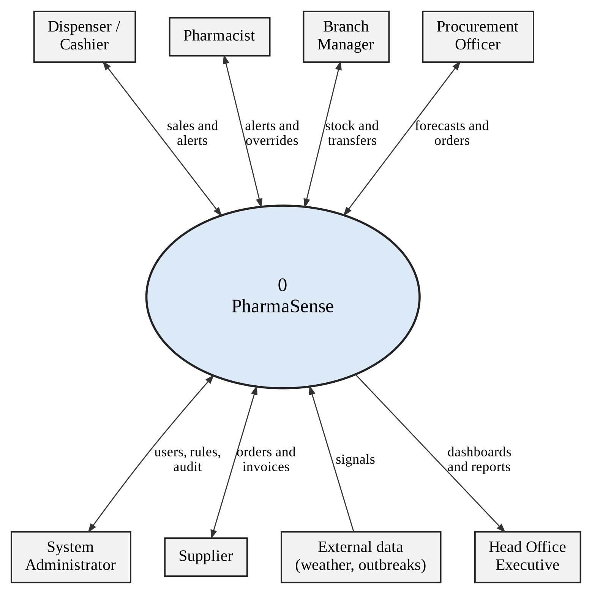

**Figure 4.1:** Context diagram of PharmaSense

4.2.2 Level 0 data flow diagram

Figure 4.2 decomposes the system into six processes and five data stores; data flows are numbered and defined in Table 4.1. The processes are coloured by objective: red for Objective 2 (process 2.0, screen interactions), green for Objective 1 (process 4.0, forecast demand) and blue for Objective 3 (processes 5.0 and 6.0, recommendations and dashboards), with yellow for the core data processes that all three depend on. Process 2.0 sits between selling and the rules store, which is the structural difference from the existing system: no sale completes without passing through it. The story reads left to right: sell safely, keep stock, forecast, recommend, report.

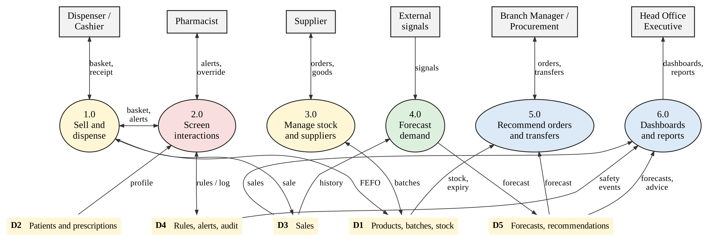

**Figure 4.2:** Level 0 data flow diagram of PharmaSense

**Table 4.1:** Numbered data flows of the level 0 diagram

| **Flow** | **From**                           | **To**                             | **Data**                         |
|----------|------------------------------------|------------------------------------|----------------------------------|
| F1       | Dispenser / Cashier                | 1.0 Sell and dispense              | basket                           |
| F2       | 1.0 Sell and dispense              | Dispenser / Cashier                | receipt                          |
| F3       | 1.0 Sell and dispense              | 2.0 Screen interactions            | basket                           |
| F4       | 2.0 Screen interactions            | 1.0 Sell and dispense              | graded alerts                    |
| F5       | 2.0 Screen interactions            | Pharmacist                         | interruptive alert               |
| F6       | Pharmacist                         | 2.0 Screen interactions            | override decision and reason     |
| F7       | D2 Patients and prescriptions      | 2.0 Screen interactions            | medicines, allergies, conditions |
| F8       | D4 Rules, alerts, audit            | 2.0 Screen interactions            | interaction rules                |
| F9       | 2.0 Screen interactions            | D4 Rules, alerts, audit            | alert and override log           |
| F10      | 1.0 Sell and dispense              | D3 Sales                           | completed sale                   |
| F11      | 1.0 Sell and dispense              | D1 Products, batches, stock        | FEFO batch deduction             |
| F12      | Supplier                           | 3.0 Manage stock and suppliers     | deliveries and invoices          |
| F13      | 3.0 Manage stock and suppliers     | Supplier                           | purchase orders                  |
| F14      | 3.0 Manage stock and suppliers     | D1 Products, batches, stock        | received batches, adjustments    |
| F15      | D3 Sales                           | 4.0 Forecast demand                | sales history                    |
| F16      | External signals                   | 4.0 Forecast demand                | weather and outbreak signals     |
| F17      | 4.0 Forecast demand                | D5 Forecasts, recommendations      | forecasts with intervals         |
| F18      | D5 Forecasts, recommendations      | 5.0 Recommend orders and transfers | forecasts                        |
| F19      | D1 Products, batches, stock        | 5.0 Recommend orders and transfers | stock and expiry                 |
| F20      | 5.0 Recommend orders and transfers | Branch Manager / Procurement       | suggested orders and transfers   |
| F21      | Branch Manager / Procurement       | 5.0 Recommend orders and transfers | approval or rejection            |
| F22      | D3 Sales                           | 6.0 Dashboards and reports         | sales figures                    |
| F23      | D4 Rules, alerts, audit            | 6.0 Dashboards and reports         | safety events                    |
| F24      | D5 Forecasts, recommendations      | 6.0 Dashboards and reports         | forecasts and advice             |
| F25      | 6.0 Dashboards and reports         | Head Office Executive              | dashboards and reports           |

Flows F22 to F24 carry the figures used by dashboards and reports. User, product and rule maintenance by the administrator, and the audit trail, are inside processes 2.0 and 3.0 and are not drawn, to keep the diagram readable.

4.2.3 Level 1 data flow diagram: dispensing with screening

Figure 4.3 expands processes 1.0 and 2.0 into four steps. The basket and patient context are resolved to active ingredients and classes, the rules are applied, alerts are graded, acknowledgements and overrides are logged, and only then are batches allocated and the sale completed. Scan-assisted capture (Section 4.5.5) is an additional way of building the basket in process 1.1; it produces the same basket structure after pharmacist confirmation, so the data flows in Figure 4.3 do not change.

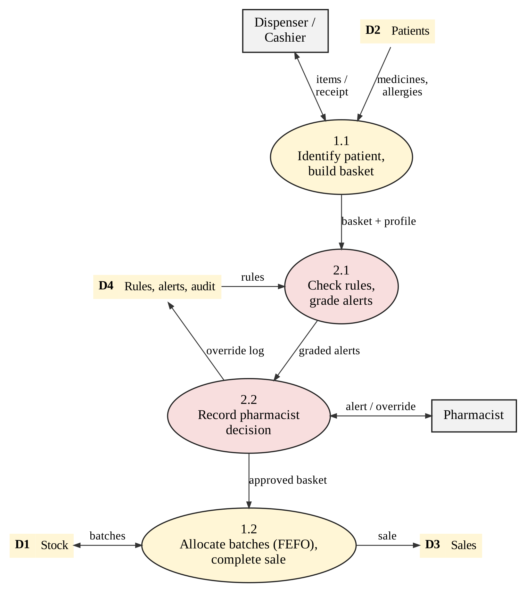

**Figure 4.3:** Level 1 data flow diagram: dispensing with interaction screening

4.2.4 Activity diagrams

Figure 4.4 shows the counter workflow. The branch taken depends on the highest severity found: S1 and S2 interrupt and require a decision, S3 and S4 inform without interrupting, and no alert proceeds straight to batch allocation. Figure 4.5 shows the nightly forecasting and replenishment flow, including the fallback to the baseline when the model does not beat it.

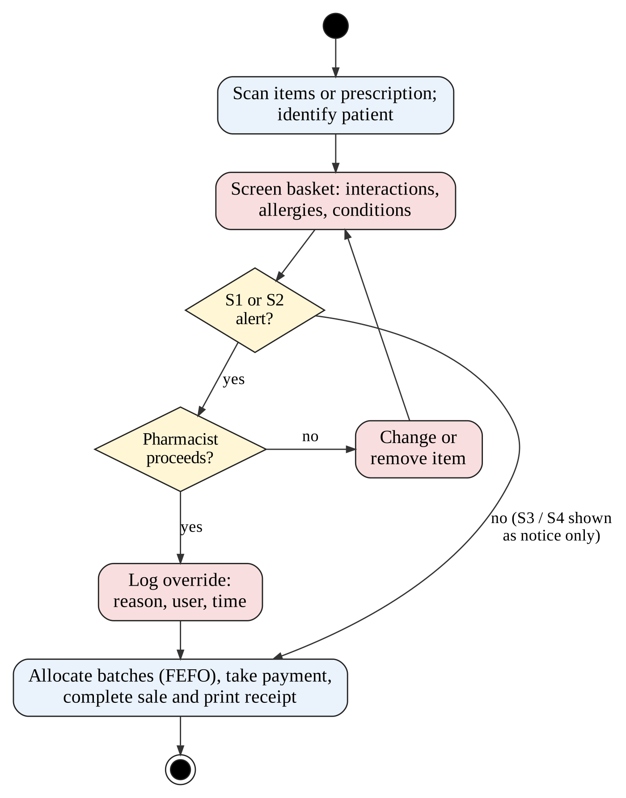

**Figure 4.4:** Activity diagram: dispense with interaction screening

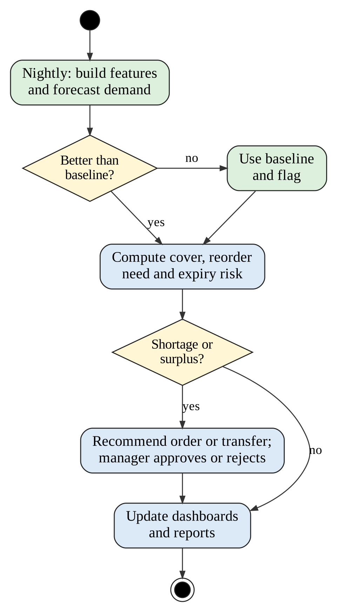

**Figure 4.5:** Activity diagram: nightly forecast, transfer and order recommendation

4.3 Architectural Design

4.3.1 Logical architecture

Figure 4.6 shows a three-tier architecture. The client tier is a React single-page application with a service worker. The application tier is a FastAPI service behind an Nginx reverse proxy, with separate service modules for core operations, the interaction engine (Objective 2), the forecasting service (Objective 1) and the decision-support layer (Objective 3), plus a background worker for scheduled runs. The data tier is a PostgreSQL database holding the transactional schema, the feature views, the knowledge base and the audit schema.

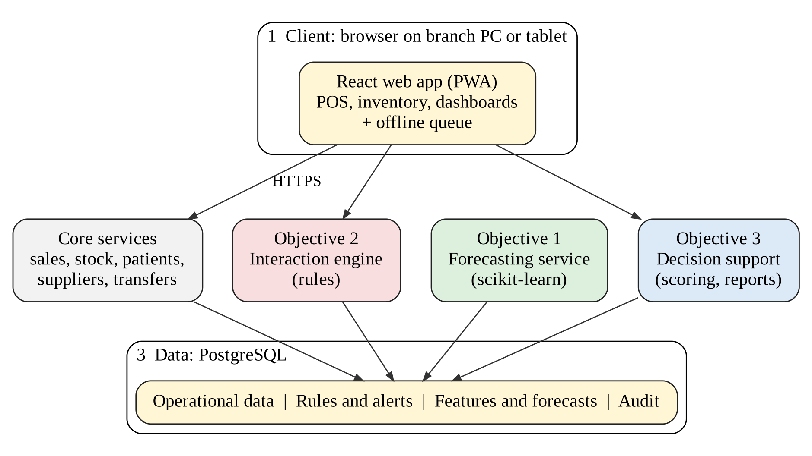

**Figure 4.6:** Logical architecture of PharmaSense

4.3.2 Technology decisions

Each choice below rests on published evidence where it exists and on fit with the requirements of Chapter Three where it does not. The studies have limits, which are stated in the table, so none of them is treated as proof; the choices that matter most (the forecasting model and the OCR engine) are kept replaceable and will be tested against baselines in Chapter Five.

**Table 4.2:** Technology decisions: alternatives set aside, and the evidence and reasons

| **Decision**                                                                        | **Alternatives set aside**                                      | **Evidence and reasons**                                                                                                                                                                                                                                                                                                                                                                                                                                                                                                                             |
|-------------------------------------------------------------------------------------|-----------------------------------------------------------------|------------------------------------------------------------------------------------------------------------------------------------------------------------------------------------------------------------------------------------------------------------------------------------------------------------------------------------------------------------------------------------------------------------------------------------------------------------------------------------------------------------------------------------------------------|
| Back end: FastAPI (Python)                                                          | Flask, Django, Node.js                                          | Screening, forecasting and scoring are Python, so one language serves the API and the models. A 2025 benchmark of Python frameworks found FastAPI faster than Flask and Django, for example about 4,800 simple GET requests per second against about 2,700 and 1,660, and noted that ORM layers cost 8–11% and that servers were not tuned for each framework \[44\]. Node.js was not in that study; it is set aside for language unity, not speed.                                                                                                  |
| Database: PostgreSQL                                                                | MongoDB and other document stores                               | Stock and sales need ACID transactions, foreign keys and joins; SQL window functions create the lag and rolling features inside the database. In a 2026 comparison on e-commerce data, PostgreSQL ran complex analytical queries 1.6 to 15.1 times faster than MongoDB, while MongoDB used about 33% less disk space; the test was read-only, on one machine and mostly without indexes \[45\].                                                                                                                                                      |
| Forecast model: histogram gradient boosting (scikit-learn) with quantile loss       | LSTM and other deep networks; ARIMA or Prophet alone; XGBoost   | Tree ensembles led the M5 retail competition \[24\] and remain strong on medium-sized tabular data \[11\]. In single-pharmacy sales data XGBoost won on percentage error in four of eight groups, classical methods won others and an LSTM was limited by small data \[29\]. Scikit-learn’s estimator supports quantile loss, missing values and categorical features natively and is inspired by LightGBM \[46\]; XGBoost \[25\] is the same family and a drop-in alternative if tests show a gain. ARIMA and seasonal-naive are kept as baselines. |
| Interaction engine: curated rules                                                   | Generative language model; opaque classifier                    | Language models gave inconclusive or incorrect interaction answers in some studies and had specificity of 0.36–0.68 \[20\], \[21\]; grounding in a knowledge base reduced hallucination but did not test interactions \[22\]. Rules are reproducible, sourced and auditable, which the override log and NFR-10 require. A model may later assist review but not decide an alert.                                                                                                                                                                     |
| Recommendations: explicit scoring with adjustable weights                           | Black-box ranking model                                         | Reviews of pharmaceutical forecasting call for interpretable methods \[27\]; managers can read and change weights, and each recommendation lists its components.                                                                                                                                                                                                                                                                                                                                                                                     |
| Client: progressive web app with local queue                                        | Native mobile or desktop client                                 | A PWA runs offline after an initial download and from one code base across platforms \[34\]. Power and connectivity are documented constraints in Zimbabwe \[33\], and the camera and service worker are available in the browser, which the scanning extension also needs.                                                                                                                                                                                                                                                                          |
| Live dashboards: server-sent events                                                 | Constant polling                                                | One-way push over HTTP suits dashboards; low overhead and simple to deploy behind Nginx.                                                                                                                                                                                                                                                                                                                                                                                                                                                             |
| Scanning: on-premise open-source readers with fuzzy matching and human confirmation | Cloud vision-language model; autonomous handwriting recognition | General vision-language models scored only 2–8% F1 on prescriptions without fine-tuning \[40\], and a recogniser fell from 1.4% to about 13.5% error from validation to test \[39\]. Prescription images are personal data \[12\], and connectivity is unreliable, so processing stays on the pharmacy’s server and every line is confirmed (Section 4.5.5).                                                                                                                                                                                         |

4.3.3 Hardware and network design

Figure 4.7 shows the deployment. Each branch has a local network with one or more point-of-sale terminals, a barcode scanner, a receipt printer and a router with a battery backup (UPS) to ride through short power cuts. Branches and head office reach the cloud server over the internet using TLS; a mobile-data connection is a failover where fibre is unreliable. The server sits behind a firewall that exposes only port 443, and the database listens only on the private network. Hardware requirements are in Table 4.3.

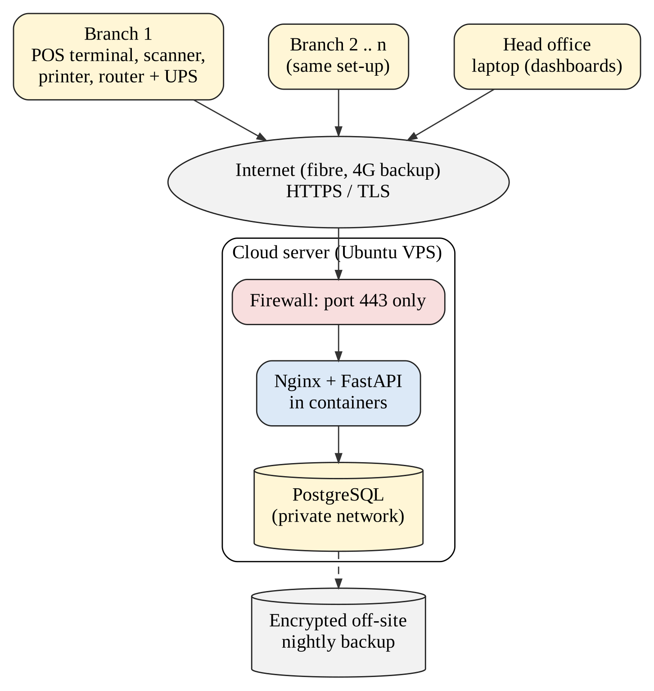

**Figure 4.7:** Deployment and network architecture

**Table 4.3:** Hardware and infrastructure specification

| **Item**            | **Minimum specification**                                                                              | **Quantity**         |
|---------------------|--------------------------------------------------------------------------------------------------------|----------------------|
| Branch POS terminal | Dual-core CPU, 4 GB RAM, current Chrome, Edge or Firefox; or tablet with equivalent browser            | 1 or more per branch |
| Barcode scanner     | USB 2D imager, keyboard-wedge mode; EAN-13, Code 128 and GS1 DataMatrix \[43\]; or the terminal camera | 1 per terminal       |
| Receipt printer     | Thermal 80 mm, USB or network                                                                          | 1 per branch         |
| Router and UPS      | Router with 4G failover option; UPS giving at least 30 minutes for terminal and router                 | 1 per branch         |
| Cloud server (VPS)  | Ubuntu LTS, 4 vCPU, 8 GB RAM, 100 GB SSD; Docker                                                       | 1 (pilot)            |
| Backup storage      | Encrypted off-site object storage, 30-day retention                                                    | 1                    |

4.3.4 Offline-tolerant point of sale

A service worker caches the application and a compact copy of the interaction rules and product list; IndexedDB holds the current branch’s recent patient profiles and a queue of unsent transactions. When the server is unreachable, the terminal screens baskets against the cached rules, completes the sale locally and stores the sale, the alerts shown and any override. On reconnection, the queue is replayed in order with idempotency keys so that a sale is never posted twice. Stock is reconciled on the server; if replay shows that a batch has been exhausted elsewhere, the sale is accepted but flagged for the branch manager to resolve. The cached rule set carries a version stamp so that a terminal never silently uses rules older than a configurable limit.

4.3.5 Security design

**Table 4.4:** Security and privacy controls

| **Control**         | **Design**                                                                                                                           | **Requirement** |
|---------------------|--------------------------------------------------------------------------------------------------------------------------------------|-----------------|
| Authentication      | Salted slow password hash (Argon2 or bcrypt); lock-out after repeated failures; PIN re-entry for overrides                           | NFR-06          |
| Authorisation       | Role-based access control with least privilege enforced in the API, not only in the interface                                        | FR-01           |
| Transport security  | TLS 1.2 or higher on all connections; HSTS; database not exposed publicly                                                            | NFR-06          |
| Audit and integrity | Append-only audit and override tables; application database role has no update or delete privilege on them                           | NFR-08          |
| Data minimisation   | National ID stored only as a salted hash; consent flag per patient; research extracts anonymised                                     | NFR-07          |
| Image privacy       | Prescription images processed on the pharmacy server, encrypted at rest, deleted or retained per policy, never sent to third parties | NFR-15          |
| Backup              | Encrypted nightly backups, restore tested each month                                                                                 | NFR-13          |
| Testing             | OWASP ZAP scan of the API and web app; dependency scanning                                                                           | NFR-06          |

4.4 Database Design

4.4.1 Entity-relationship diagrams

The schema has about 35 tables. Figure 4.8 gives the overview in thirteen entities, coloured by objective: red for the interaction-safety tables, green for forecasting, blue for recommendations, and yellow for the core stock and sales data. Batch is the central entity: stock, sales, transfers, receipts and stocktakes all refer to a batch, which is what enables FEFO and expiry-aware recommendations. A crow’s foot marks the “many” end and a double bar the “one” end. The full column-level diagrams are in Appendix C. Two tables for scan-assisted capture, scan_capture and scan_line (Section 4.5.5), are listed in the data dictionary but omitted from the diagrams to keep them legible.

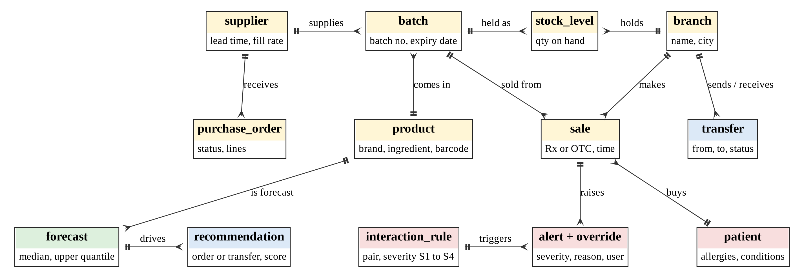

**Figure 4.8:** Entity-relationship overview of PharmaSense

4.4.2 Normalisation

The design is in third normal form (3NF). Table 4.5 shows why, using the paper dispensing slip as the unnormalised starting point. Repeating groups (several items per slip) violate first normal form (1NF). Product details depend on the product alone, not on the whole slip-and-item key, which violates second normal form (2NF). Ingredient names and branch city depend on non-key attributes, which violates 3NF. The resulting relations are in Table 4.6.

**Table 4.5:** Unnormalised dispensing slip (UNF)

| **SLIP(slip_no, sold_at, branch_name, branch_city, patient_name, patient_phone, {product_name, dosage_form, ingredient_names, qty, batch_no, expiry_date, unit_price})** |
|--------------------------------------------------------------------------------------------------------------------------------------------------------------------------|

**Table 4.6:** Normalisation steps for the dispensing slip

| **Step** | **Result**                                                                                                                                                                                                                                                                                                                                                                                                                                                |
|----------|-----------------------------------------------------------------------------------------------------------------------------------------------------------------------------------------------------------------------------------------------------------------------------------------------------------------------------------------------------------------------------------------------------------------------------------------------------------|
| 1NF      | Remove the repeating group: SALE(sale_id, sold_at, branch_name, branch_city, patient_name, patient_phone) and SALE_LINE(sale_id, line_no, product_name, dosage_form, ingredient_names, qty, batch_no, expiry_date, unit_price). Make ingredient_names atomic by moving it to its own rows.                                                                                                                                                                |
| 2NF      | Remove partial dependencies on the composite key (sale_id, line_no): product_name and dosage_form depend only on product, batch_no and expiry_date only on batch. Create PRODUCT(product_id, brand_name, dosage_form) and BATCH(batch_id, product_id, batch_no, expiry_date); SALE_LINE keeps (sale_id, line_no, product_id, qty, unit_price).                                                                                                            |
| 3NF      | Remove transitive dependencies: branch_city depends on branch, not on the sale: BRANCH(branch_id, name, city). Patient attributes move to PATIENT(patient_id, name, phone). Product-to-ingredient is many-to-many: ACTIVE_INGREDIENT(ingredient_id, inn_name) and PRODUCT_INGREDIENT(product_id, ingredient_id). A sale line draws on batches through SALE_LINE_BATCH(sale_line_id, batch_id, qty_from_batch), which supports FEFO splits across batches. |

4.4.3 Data dictionary (key tables)

**Table 4.7:** Data dictionary for key tables

| **Table.column**               | **Type** | **Constraint**                                              | **Description**                                                             |
|--------------------------------|----------|-------------------------------------------------------------|-----------------------------------------------------------------------------|
| batch.batch_id                 | bigint   | PK                                                          | Surrogate key of a received batch                                           |
| batch.product_id               | int      | FK, not null                                                | Product this batch belongs to                                               |
| batch.expiry_date              | date     | not null, \> received_date                                  | Used for FEFO and expiry-risk scoring                                       |
| stock_level.qty_on_hand        | int      | \>= 0                                                       | Units of the batch in a branch; changed only by movement transactions       |
| sale.channel                   | enum     | Rx \| OTC                                                   | Prescription or over-the-counter sale                                       |
| sale.patient_id                | int      | FK, null for anonymous OTC                                  | Required when channel is Rx                                                 |
| sale_line_batch.qty_from_batch | int      | \> 0                                                        | Units drawn from a batch; sum equals sale_line.qty                          |
| interaction_rule.rule_type     | enum     | pair \| allergy \| condition                                | Kind of conflict the rule describes                                         |
| interaction_rule.severity      | enum     | S1 \| S2 \| S3 \| S4                                        | Contraindicated, major, moderate, minor                                     |
| interaction_rule.source_ref    | text     | not null                                                    | Reference to the source of the rule, for audit                              |
| interaction_rule.validated_by  | int      | FK user, null until validated                               | Pharmacist who validated; unvalidated rules are not enforced                |
| alert_override.reason_code     | enum     | not null                                                    | Coded clinical reason; free text optional                                   |
| forecast_result.q50_units      | numeric  | \>= 0                                                       | Median forecast for the week                                                |
| forecast_result.q90_units      | numeric  | \>= q50_units                                               | Upper quantile used for safety stock                                        |
| scan_capture.image_ref         | text     | null after deletion                                         | Reference to the encrypted image; removed when the retention rule expires   |
| scan_line.confidence           | numeric  | 0 to 1                                                      | Match confidence; lines below the threshold need manual product selection   |
| scan_line.confirmed_by         | int      | FK user, null until confirmed                               | Pharmacist who confirmed the line; unconfirmed lines never enter the basket |
| transfer.status                | enum     | REQUESTED \| APPROVED \| IN_TRANSIT \| RECEIVED \| REJECTED | State of the transfer workflow                                              |
| audit_log.before_after_json    | jsonb    | append-only                                                 | Old and new values of the changed record                                    |

4.4.4 Feature pipeline and integrity rules

The feature pipeline for Objective 1 is a set of SQL views over sales and stock. A weekly series is generated for every product-branch pair, including weeks with no sales, because missing weeks are zeros, not gaps. Window functions then produce lags and rolling means, and calendar and signal joins add week of year, month, public-holiday and outbreak flags. A stock-out indicator marks weeks where stock was zero for most of the week, since sales in those weeks understate demand and must be flagged rather than learned as low demand. Table 4.8 lists the features. Integrity is enforced in the database: foreign keys, check constraints on quantities and dates, a trigger that prevents stock from going negative, and revocation of update and delete rights on audit tables.

**Table 4.8:** Candidate features for the demand model

| **Feature group**           | **Features**                                                                                               | **Source**                  |
|-----------------------------|------------------------------------------------------------------------------------------------------------|-----------------------------|
| Target                      | Units sold per product, branch and week                                                                    | sale, sale_line             |
| Lags and rolling statistics | Lag 1, 2, 4 and 52 weeks; rolling mean and standard deviation over 4 and 8 weeks; zero-sales streak length | SQL window functions        |
| Calendar                    | Week of year, month, public-holiday and school-term flags, days to month-end                               | Calendar table              |
| External signals            | Outbreak alert flag, rainfall anomaly, region                                                              | external_signal             |
| Product and branch          | Product category (ATC level 2), dosage form, price band, branch (categorical)                              | product, branch             |
| Availability                | Stock-out days in the week; on-order quantity                                                              | stock_level, purchase_order |

4.5 Program Design

4.5.1 Package diagram

Figure 4.9 shows the six packages and their dependencies. Dependencies point downwards: presentation depends on the API, the API on services, and services on the domain, data access and infrastructure packages. The three objectives live in separate service modules, so each can be tested alone.

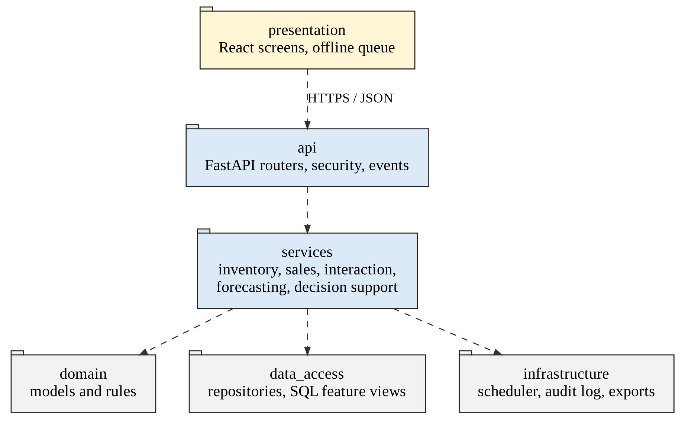

**Figure 4.9:** Package diagram

4.5.2 Class diagrams

Figure 4.10 gives the core domain classes; Figure 4.11 gives the classes of the intelligence layer. Classes are coloured by objective (red for Objective 2, green for Objective 1, blue for Objective 3). ForecastModel is abstract with two implementations, so that the seasonal-naive baseline and the gradient-boosting model can be swapped and compared by the same service.

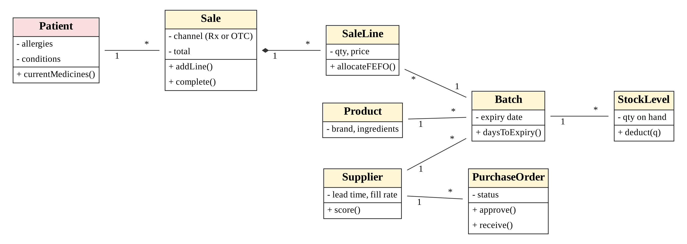

**Figure 4.10:** Class diagram: core domain

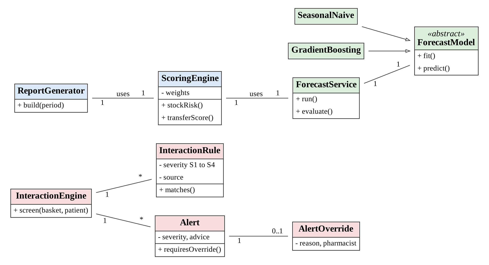

**Figure 4.11:** Class diagram: intelligence layer

4.5.3 Sequence diagrams

Figure 4.12 shows the interaction screening sequence of Objective 2, from scan to receipt. Figure 4.13 shows the nightly run that links Objectives 1 and 3.

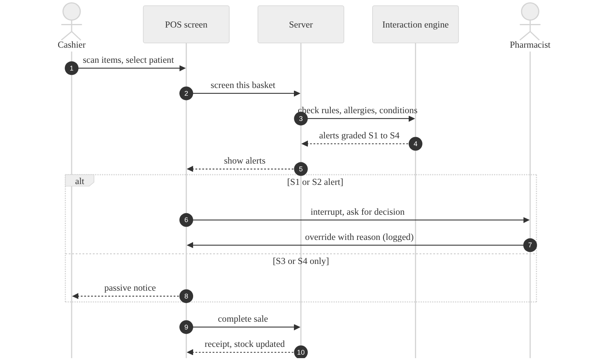

**Figure 4.12:** Sequence diagram: dispense with interaction screening

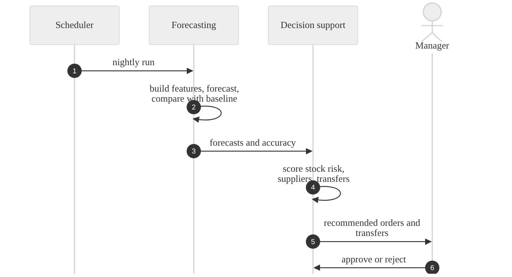

**Figure 4.13:** Sequence diagram: nightly forecast, scoring and recommendation

4.5.4 Algorithms and pseudocode

Algorithm 1: interaction screening (Objective 2)

The engine resolves each basket item to active ingredients, then to ingredient classes, and matches three kinds of rule. Only validated rules are enforced. The output is sorted by severity so that the worst finding drives the interface.

**Pseudocode: interaction screening and sale completion**

> FUNCTION screen_basket(basket, patient):
>
> items \<- basket.items + patient.current_medicines
>
> ingredients \<- UNION(ingredients_of(i) FOR i IN items)
>
> classes \<- UNION(classes_of(g) FOR g IN ingredients)
>
> alerts \<- EMPTY LIST
>
> // 1. drug-drug rules: at least one side must be in the new basket
>
> FOR EACH rule IN rules WHERE rule.type = 'pair' AND rule.validated:
>
> IF matches(rule.a, ingredients, classes) AND matches(rule.b, ingredients, classes)
>
> AND (involves_new_item(rule, basket)):
>
> alerts.ADD(make_alert(rule, evidence = pair_found))
>
> // 2. allergy rules: basket ingredient against recorded allergies
>
> FOR EACH allergy IN patient.allergies:
>
> FOR EACH rule IN rules WHERE rule.type = 'allergy' AND rule.validated:
>
> IF rule.allergen_class CONTAINS allergy.ingredient
>
> AND basket_has_class(rule.drug_class): alerts.ADD(make_alert(rule, allergy))
>
> // 3. condition rules: basket ingredient against recorded conditions
>
> FOR EACH cond IN patient.conditions:
>
> FOR EACH rule IN rules WHERE rule.type = 'condition' AND rule.validated:
>
> IF rule.condition = cond.code AND basket_has_class(rule.drug_class):
>
> alerts.ADD(make_alert(rule, cond))
>
> alerts \<- DEDUPLICATE(alerts); SORT alerts BY severity ASCENDING // S1 first
>
> FOR EACH a IN alerts: a.interruptive \<- (a.severity IN {S1, S2})
>
> RETURN alerts
>
> FUNCTION complete_sale(sale, alerts, overrides):
>
> FOR EACH a IN alerts WHERE a.interruptive:
>
> IF NOT EXISTS override FOR a WITH reason_code AND authenticated_pharmacist:
>
> RAISE "override required"
>
> APPEND alert_override(a, override) TO audit tables
>
> allocate_fefo(sale); SAVE sale

Algorithm 2: FEFO batch allocation

**Pseudocode: first-expiry-first-out allocation**

> FUNCTION allocate_fefo(product, qty, branch):
>
> batches \<- stock_level WHERE branch = branch AND product = product
>
> AND qty_on_hand \> 0 AND batch.expiry_date \> today
>
> ORDER BY batch.expiry_date ASC
>
> remaining \<- qty; plan \<- EMPTY LIST
>
> FOR EACH b IN batches:
>
> take \<- MIN(b.qty_on_hand, remaining)
>
> plan.ADD((b, take)); remaining \<- remaining - take
>
> IF remaining = 0: BREAK
>
> IF remaining \> 0: RAISE "insufficient stock"
>
> BEGIN TRANSACTION
>
> FOR EACH (b, take) IN plan: UPDATE stock_level SET qty_on_hand = qty_on_hand - take
>
> INSERT sale_line_batch rows
>
> COMMIT

Algorithm 3: demand forecasting pipeline (Objective 1)

One global model is trained across all product-branch series with product and branch as categorical features, using scikit-learn’s histogram gradient boosting regressor with quantile loss for the median (0.5) and the upper quantile (0.9). A global model shares strength between related products, which helps with sparse series. Evaluation uses rolling-origin validation so that the model never sees the future. The seasonal-naive baseline predicts the value of the same week last year; a Croston-type estimator with the Syntetos–Boylan correction \[15\] is used as a second baseline for intermittent items.

**Pseudocode: nightly forecasting run**

> FUNCTION nightly_forecast(as_of):
>
> REFRESH MATERIALIZED VIEW mv_weekly_features
>
> data \<- READ mv_weekly_features WHERE week_start \<= as_of
>
> folds \<- ROLLING_ORIGIN_SPLITS(data, horizon = 8 weeks, n = 5) // time-ordered
>
> FOR EACH fold IN folds:
>
> FIT q50_model, q90_model ON fold.train // HistGradientBoosting, quantile loss
>
> PREDICT fold.test; RECORD WAPE, bias, interval_coverage
>
> PREDICT baselines (seasonal_naive, croston_sba) ON fold.test
>
> use_model \<- MEAN(wape_model) \< MEAN(wape_baseline) \* 0.95
>
> IF NOT use_model: FLAG "baseline in use"
>
> FIT final models ON all data up to as_of
>
> FOR EACH (product, branch) FOR next 8 weeks:
>
> q50, q90 \<- predict (or baseline if NOT use_model)
>
> STORE forecast_result(run_id, product, branch, week, q50, q90)
>
> STORE forecast_run(metrics, use_model)
>
> METRICS: WAPE = SUM\|y - yhat\| / SUM y ; bias = SUM(yhat - y) / SUM y
>
> coverage = share of weeks with y \<= q90

Algorithm 4: replenishment and transfer scoring (Objective 3)

The scoring layer converts forecasts and stock into ranked actions. For a product at a branch, with lead time L days and review period T days, let D50(h) and D90(h) be the median and upper-quantile demand over h days from the forecast. The definitions below use default weights that managers can adjust; they will be tested for sensitivity in Chapter Five.

- **Safety stock** SS = D90(L) − D50(L). **Reorder point** ROP = D90(L). **Suggested order quantity** Q = max(0, D90(L + T) − (on hand + on order)).

- **Stock-out risk** at the receiving branch j: R_s(j) = min(1, max(0, D90(L) − on_hand_j) / D90(L)).

- **Expiry risk** of batch b at the donor branch i: R_e(i, b) = min(1, max(0, on_hand_b − D50(until expiry of b)) / on_hand_b). It is high when the forecast says the batch will not sell before it expires.

- **Transfer score** for moving quantity Q of a product from i to j: Score = w1·R_s(j) + w2·R_e(i, b) + w3·min(1, Q / need_j) − w4·(c_ij / c_max), with default weights (0.40, 0.30, 0.20, 0.10) summing to 1, where need_j = D90(L) − on_hand_j and c_ij is transport cost. A transfer is eligible only if the donor keeps at least D50(L) after sending.

- **Supplier score** = 0.4·fill rate + 0.3·on-time rate + 0.3·price score, where price score is 1 for the lowest unit price and falls linearly with the price gap. Weights are adjustable.

- **Stock-health class** of a product at a branch: out of stock, low (cover below lead time), healthy, or excess (cover above a policy ceiling), with cover = on hand / daily median demand.

**Pseudocode: ranking inter-branch transfer recommendations**

> FUNCTION recommend_transfers(run_id):
>
> recs \<- EMPTY LIST
>
> FOR EACH product p:
>
> receivers \<- branches j WITH R_s(j, p) \>= 0.5 ORDER BY R_s DESC
>
> FOR EACH j IN receivers:
>
> FOR EACH donor i != j WITH eligible_surplus(i, p) \> 0:
>
> b \<- earliest-expiry batch of p at i with spare quantity
>
> Q \<- MIN(spare(i, b), need(j, p))
>
> IF Q \> 0: recs.ADD((p, i, j, b, Q, transfer_score(p, i, j, b, Q)))
>
> RANK recs BY score DESC; KEEP best donor per (p, j)
>
> STORE recommendations WITH component values // shown to the manager as the reason
>
> RETURN recs

Algorithm 5: smart report narrative

Smart-report summaries are generated by deterministic templates, not by a generative language model, so that every sentence can be traced to a number. The generator compares each indicator with the previous period, selects the largest changes above a materiality threshold, adds the likely driver from the features or events recorded (for example an active outbreak flag), and attaches the matching recommended action.

**Pseudocode: scheduled smart report**

> FUNCTION build_report(def, period):
>
> kpis_now \<- compute_kpis(def.scope, period)
>
> kpis_prev \<- compute_kpis(def.scope, previous(period))
>
> changes \<- SORT(\[(k, pct_change(kpis_now\[k\], kpis_prev\[k\])) FOR k IN kpis_now\]
>
> BY ABS(pct_change) DESC)
>
> top \<- FIRST 3 OF changes WHERE ABS(pct_change) \>= def.materiality
>
> FOR EACH (k, delta) IN top:
>
> driver \<- lookup_driver(k, period) // e.g. outbreak flag, new supplier
>
> action \<- lookup_action(k, delta) // e.g. "Approve transfer T-0411"
>
> sentence \<- TEMPLATE\[k\](delta, driver, action)
>
> RETURN report(table = kpis_now, narrative = JOIN(sentences))

4.5.5 Scan-assisted capture (extension to Objective 2)

Scanning is designed as an input channel to the dispensing flow, not as a new decision module. Figure 4.14 shows the pipeline. A captured image is first classified. Barcodes and GS1 DataMatrix codes follow a deterministic path that decodes the product code, batch and expiry date and looks them up in the product and batch tables. Printed and handwritten prescriptions are recognised as text, entities are extracted, and each line is matched to the product catalogue with a confidence score. The output is a set of draft lines on a review screen (Figure 4.16); nothing enters the basket until a pharmacist confirms the line, and confirmed baskets are then screened for interactions exactly like typed ones.

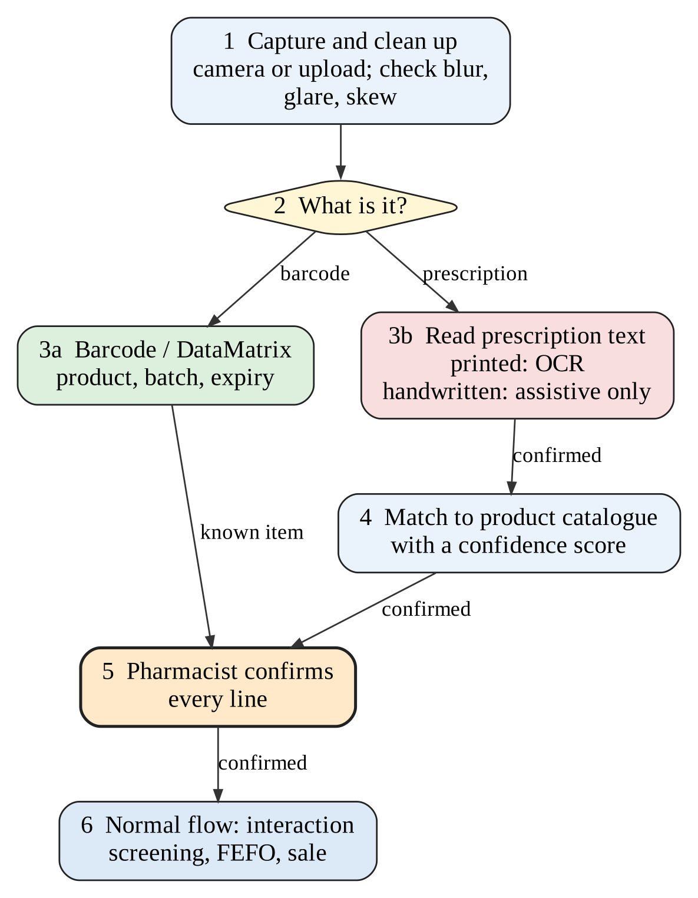

**Figure 4.14:** Scan-assisted capture pipeline

The design follows from the evidence in Section 2.3.7. First, barcode scanning is deterministic and benefits only when scanning is required \[41\], so the counter and receiving screens take a scan as the default way to add a product. Second, handwriting recognition errors on unseen prescriptions are large \[39\], \[40\], so the recogniser is assistive: confidence below a threshold (initially 85%, to be tuned on the test set) forces manual selection, and the screen always shows the image beside the draft. Third, images are personal data, so they are processed on the pharmacy’s own server or terminal and stored encrypted only as the retention rule requires (NFR-15). Table 4.9 compares the options considered.

**Table 4.9:** Scanning options considered

| **Option**                                                                                             | **Strength**                                                                    | **Limit**                                                                                   | **Decision**                                                        |
|--------------------------------------------------------------------------------------------------------|---------------------------------------------------------------------------------|---------------------------------------------------------------------------------------------|---------------------------------------------------------------------|
| Linear barcode (EAN-13, Code 128) and GS1 DataMatrix, read in the browser or by a 2D imager            | Deterministic; fast; DataMatrix can carry batch and expiry \[43\]               | DataMatrix needs a camera-based reader; coverage on local stock unknown                     | Adopt (FR-33); fall back to manual entry                            |
| Printed prescription: open-source OCR engine on the pharmacy server, then fuzzy match to the catalogue | No cost per scan; images stay on site; works for typed or stamped prescriptions | Accuracy depends on print and photo quality; to be benchmarked                              | Adopt as assistive (FR-34); benchmark engines in Chapter Five       |
| Handwritten prescription: transformer recogniser such as TrOCR \[38\], fine-tuned                      | Best published results for handwriting \[39\]                                   | Needs local training data and GPU time; error 13.5% on unseen test; rare drugs worse \[40\] | Pilot only; keep the image beside the draft; report accuracy openly |
| Cloud vision-language model                                                                            | Little set-up                                                                   | Weak zero-shot results \[40\]; images leave the pharmacy; needs connectivity                | Not adopted                                                         |
| Manual entry (current practice)                                                                        | Always available                                                                | Slow; typing and reading errors \[36\]                                                      | Kept as the fallback                                                |

**Pseudocode: scan-assisted capture with pharmacist confirmation**

> FUNCTION scan_prescription(image, branch, user):
>
> q \<- quality_check(image) // blur, glare, skew, resolution
>
> IF q.poor: RETURN "retake photo", q.reason
>
> image \<- deskew_and_crop(image)
>
> kind \<- classify(image) // BARCODE \| PRINTED \| HANDWRITTEN
>
> IF kind = BARCODE:
>
> code \<- decode(image) // GTIN, batch, expiry, serial
>
> RETURN lookup_product_and_batch(code)
>
> text \<- OCR(image) IF kind = PRINTED ELSE handwriting_recognise(image)
>
> lines \<- extract_entities(text) // drug, strength, form, dose, qty
>
> draft \<- EMPTY LIST
>
> FOR EACH line IN lines:
>
> cands \<- top_k(fuzzy_match(line.drug, catalogue_names + ingredient_names), k = 3)
>
> draft.ADD((line, cands, confidence = cands\[0\].score, status = 'UNCONFIRMED'))
>
> STORE scan_capture(image_ref, kind, user, branch), scan_line(draft)
>
> RETURN draft
>
> FUNCTION confirm_line(line, chosen_product, pharmacist):
>
> IF line.confidence \< THRESHOLD AND chosen_product IS NULL: RAISE "select product"
>
> line.status \<- 'CONFIRMED'; line.confirmed_by \<- pharmacist
>
> LOG correction IF chosen_product \<\> line.cands\[0\]
>
> basket.ADD(line) // then screen_basket() as usual

4.6 Interface Design

The interface is a single application with a left navigation grouped as Dispensing, Supply and Intelligence, a header showing the branch and user, and role-based menus. The screens below are design prototypes with sample data; they are not output from the finished system, and the patient shown is fictitious. Table 4.10 links each screen to its use cases and requirements. Additional screens (transfer recommendations, patient profile, smart report, inventory by batch and interaction rule maintenance) are in Appendix B.

**Table 4.10:** Interface screens, use cases and requirements

| **Screen**                                          | **Design intent**                                                                                                                                           | **Use cases and requirements**         |
|-----------------------------------------------------|-------------------------------------------------------------------------------------------------------------------------------------------------------------|----------------------------------------|
| Point of sale with safety review (Figure 4.15)      | Basket on the left, patient context on the right; S1 and S2 alerts shown in a modal with rationale, advice, reason code and PIN; sale locked until reviewed | UC04–07; FR-12 to FR-15                |
| Demand forecast and replenishment (Figure 4.17)     | Forecast with interval and the main drivers; suggested order with reason and supplier score; approve or amend                                               | UC15, UC16; FR-21, FR-22, FR-25, FR-26 |
| Scan prescription: review and confirm (Figure 4.16) | Image beside draft lines with confidence; low-confidence lines need manual choice; nothing enters the basket until confirmed                                | UC04 (extended); FR-33 to FR-35        |
| Chain dashboard (Figure 4.18)                       | Five headline KPIs, sales by branch, stock health and a short list of actions needing attention                                                             | UC20; FR-29                            |
| Transfer recommendations (Figure B.1, Appendix B)   | Ranked list with stock-out risk, expiry risk and score; pipeline of open transfers                                                                          | UC18, UC19; FR-27, FR-28               |

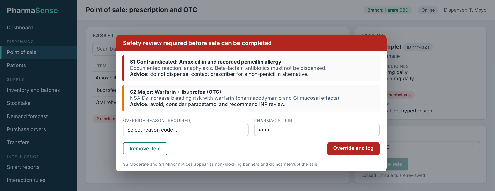

**Figure 4.15:** Prototype: point of sale with safety review modal (sample data)

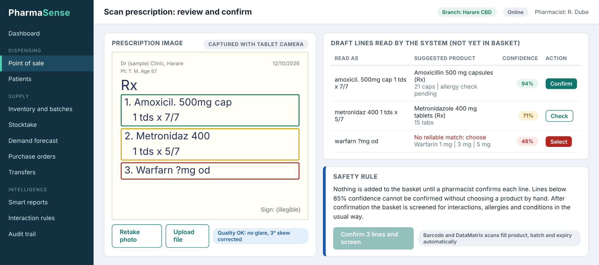

**Figure 4.16:** Prototype: prescription scan review with confidence and pharmacist confirmation (sample data)

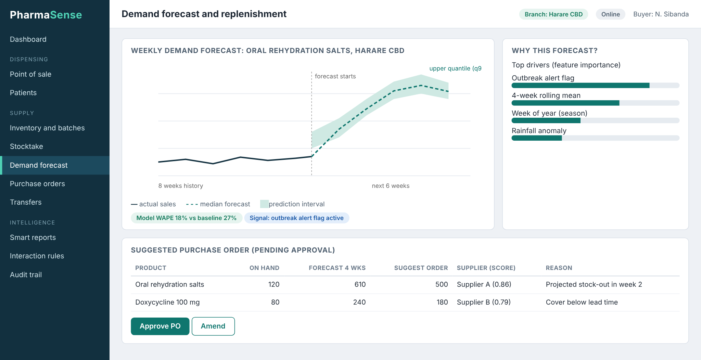

**Figure 4.17:** Prototype: demand forecast and suggested purchase order (sample data)

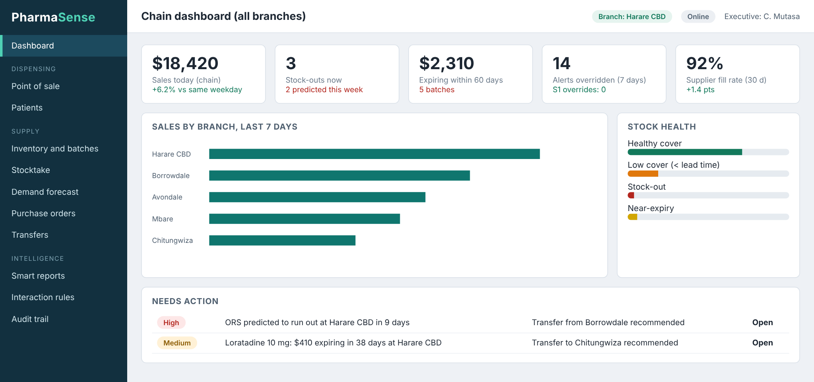

**Figure 4.18:** Prototype: chain dashboard (sample data)

4.7 Chapter Summary

The design realises the three objectives on one data foundation. The context and data flow diagrams show that no sale can complete without screening, and that forecasts, stock and expiry feed the scoring layer that drives dashboards and reports. The architecture is a three-tier web system with an offline-tolerant point of sale; the database is in third normal form with batch as the central entity; and the algorithms for screening, FEFO allocation, forecasting, scoring and report narration are specified in pseudocode; technology choices are tied to published evidence; and scan-assisted capture is designed as an assistive, pharmacist-confirmed input to the dispensing flow. Chapter Five will describe the implementation of these designs and the testing used to evaluate them against the criteria in Table 1.1.

REFERENCES

\[1\] World Health Organization, "WHO launches global effort to halve medication-related errors in 5 years," news release, Geneva, Switzerland, Mar. 29, 2017. \[Online\]. Available: https://www.who.int/news-room/detail/29-03-2017-who-launches-global-effort-to-halve-medication-related-errors-in-5-years

\[2\] I. H. van der Sijs, J. Aarts, A. G. Vulto, and M. Berg, "Overriding of drug safety alerts in computerized physician order entry," *J. Am. Med. Inform. Assoc.*, vol. 13, no. 2, pp. 138–147, Mar. 2006, doi: 10.1197/jamia.M1809.

\[3\] K. C. Nanji *et al.*, "Overrides of medication-related clinical decision support alerts in outpatients," *J. Am. Med. Inform. Assoc.*, vol. 21, no. 3, pp. 487–491, 2014, doi: 10.1136/amiajnl-2013-001813.

\[4\] K. R. Saverno *et al.*, "Ability of pharmacy clinical decision-support software to alert users about clinically important drug–drug interactions," *J. Am. Med. Inform. Assoc.*, vol. 18, no. 1, pp. 32–37, 2011, doi: 10.1136/jamia.2010.007609.

\[5\] T. Mashe *et al.*, "Descriptive epidemiology of the cholera outbreak in Zimbabwe 2018–2019: Role of multi-sectorial approach in cholera epidemic control," *BMJ Open*, vol. 13, no. 1, Art. no. e059134, 2023.

\[6\] B. Kanyemba, "Zimbabwe's medicine availability falls to 47% with expiry losses exposing supply chain failure," *Equity Axis*, Aug. 25, 2026. \[Online\]. Available: https://equityaxis.net/post/19381/2026/8/zimbabwe-s-medicine-availability-falls-to-47-with-expiry-losses-exposing-supply-chain-failure

\[7\] PioneerRx, "Auto reorder points," PioneerRx blog, Oct. 7, 2020. \[Online\]. Available: https://www.pioneerrx.com/blog/featured-feature-auto-reorder-points

\[8\] mPharma, "mPharma harnesses AWS cloud to revolutionize healthcare delivery across Africa," company statement republished by CitiNewsroom, Mar. 28, 2024. \[Online\]. Available: https://citinewsroom.com/2024/03/mpharma-harnesses-aws-cloud-to-revolutionize-healthcare-delivery-across-africa/

\[9\] J. Abarca *et al.*, "Concordance of severity ratings provided in four drug interaction compendia," *J. Am. Pharm. Assoc.*, vol. 44, no. 2, pp. 136–141, 2004, doi: 10.1331/154434504773062582.

\[10\] G. Xiong *et al.*, "DDInter: An online drug–drug interaction database towards improving clinical decision-making and patient safety," *Nucleic Acids Res.*, vol. 50, no. D1, pp. D1200–D1207, 2022, doi: 10.1093/nar/gkab880.

\[11\] L. Grinsztajn, E. Oyallon, and G. Varoquaux, "Why do tree-based models still outperform deep learning on typical tabular data?" in *Adv. Neural Inf. Process. Syst. 35 (NeurIPS 2022), Datasets and Benchmarks Track*; arXiv:2207.08815, Jul. 2022.

\[12\] Parliament of Zimbabwe, *Cyber and Data Protection Act \[Chapter 12:07\]*, Act No. 5 of 2021, Harare, Zimbabwe. \[Online\]. Available: https://zimlii.org/akn/zw/act/2021/5/eng@2022-03-11

\[13\] Parliament of Zimbabwe, *Medicines and Allied Substances Control Act \[Chapter 15:03\]*, Harare, Zimbabwe. \[Online\]. Available: https://zimlii.org/akn/zw/act/1969/14/eng@2016-12-31

\[14\] S. Phansalkar *et al.*, "Drug–drug interactions that should be non-interruptive in order to reduce alert fatigue in electronic health records," *J. Am. Med. Inform. Assoc.*, vol. 20, no. 3, pp. 489–493, 2013, doi: 10.1136/amiajnl-2012-001089.

\[15\] A. A. Syntetos and J. E. Boylan, "The accuracy of intermittent demand estimates," *Int. J. Forecast.*, vol. 21, no. 2, pp. 303–314, 2005.

\[16\] C. Paterson, G. Kiesmüller, R. Teunter, and K. Glazebrook, "Inventory models with lateral transshipments: A review," *Eur. J. Oper. Res.*, vol. 210, no. 2, pp. 125–136, Apr. 2011.

\[17\] S. Phansalkar *et al.*, "High-priority drug–drug interactions for use in electronic health records," *J. Am. Med. Inform. Assoc.*, vol. 19, no. 5, pp. 735–743, 2012, doi: 10.1136/amiajnl-2011-000612.

\[18\] J. S. Ancker *et al.*, "Effects of workload, work complexity, and repeated alerts on alert fatigue in a clinical decision support system," *BMC Med. Inform. Decis. Mak.*, vol. 17, Art. no. 36, Apr. 2017, doi: 10.1186/s12911-017-0430-8.

\[19\] R. M. Hamadouk, E. D. Albashair, F. M. Mohammed, and B. A. Yousef, "The practice of the community pharmacists in managing potential drug–drug interactions: A simulated patient visits," *Integr. Pharm. Res. Pract.*, vol. 11, pp. 71–84, 2022, doi: 10.2147/IPRP.S355675.

\[20\] A. Juhi, N. Pipil, S. Santra, S. Mondal, J. K. Behera, and H. Mondal, "The capability of ChatGPT in predicting and explaining common drug-drug interactions," *Cureus*, vol. 15, no. 3, Art. no. e36272, 2023, doi: 10.7759/cureus.36272.

\[21\] J. Sicard *et al.*, "Can large language models detect drug–drug interactions leading to adverse drug reactions?" *Ther. Adv. Drug Saf.*, vol. 16, 2025, doi: 10.1177/20420986251339358.

\[22\] Z. Liu *et al.*, "Locally deployed large language models for AI-assisted outpatient prescription review: Crossover study," *JMIR Med. Inform.*, vol. 14, Art. no. e97520, 2026, doi: 10.2196/97520.

\[23\] R. Carbonneau, K. Laframboise, and R. Vahidov, "Application of machine learning techniques for supply chain demand forecasting," *Eur. J. Oper. Res.*, vol. 184, no. 3, pp. 1140–1154, 2008.

\[24\] S. Makridakis, E. Spiliotis, and V. Assimakopoulos, "M5 accuracy competition: Results, findings, and conclusions," *Int. J. Forecast.*, vol. 38, no. 4, pp. 1346–1364, 2022, doi: 10.1016/j.ijforecast.2021.11.013.

\[25\] T. Chen and C. Guestrin, "XGBoost: A scalable tree boosting system," in *Proc. 22nd ACM SIGKDD Int. Conf. Knowl. Discovery Data Mining*, 2016, doi: 10.1145/2939672.2939785.

\[26\] K. M. Park *et al.*, "Smarter chains, safer medicines: From predictive failures to algorithmic fixes in global pharmaceutical logistics," *Forecasting*, vol. 7, no. 4, Art. no. 78, Dec. 2025, doi: 10.3390/forecast7040078.

\[27\] W. Ramadhan, E. Noersasongko, A. Syukur, and M. A. Soeleman, "Machine learning approaches for pharmaceutical demand forecasting: A bibliometric and systematic review of methods and research trends," *Ing. Syst. Inf.*, vol. 31, no. 1, pp. 179–191, Jan. 2026, doi: 10.18280/isi.310117.

\[28\] S. M. Lundberg and S.-I. Lee, "A unified approach to interpreting model predictions," in *Adv. Neural Inf. Process. Syst. 30 (NIPS 2017)*, 2017.

\[29\] K. P. Fourkiotis and A. Tsadiras, "Applying machine learning and statistical forecasting methods for enhancing pharmaceutical sales predictions," *Forecasting*, vol. 6, no. 1, pp. 170–186, Feb. 2024, doi: 10.3390/forecast6010010.

\[30\] L. Li, Y. Kang, F. Petropoulos, and F. Li, "Feature-based intermittent demand forecast combinations: Accuracy and inventory implications," arXiv:2204.08283, 2022. \[Online\]. Available: https://arxiv.org/abs/2204.08283

\[31\] G. Diriba, G. Hasen, Y. Tefera, and S. Suleman, "Assessment of the magnitude and contributing factors of expired medicines in the public pharmaceutical supply chains of Western Ethiopia," *BMC Health Serv. Res.*, vol. 23, Art. no. 791, 2023, doi: 10.1186/s12913-023-09776-y.

\[32\] D. Dowding *et al.*, "Dashboards for improving patient care: Review of the literature," *Int. J. Med. Inform.*, vol. 84, no. 2, pp. 87–100, Feb. 2015, doi: 10.1016/j.ijmedinf.2014.10.001.

\[33\] The Global Fund, "Zimbabwe digital health case study," Aug. 2025. \[Online\]. Available: https://www.theglobalfund.org/media/qksld2tg/publication_zimbabwe-digital-health_casestudy_en.pdf

\[34\] N. I. Mohammed, A. Jarde, G. Mackenzie, U. D'Alessandro, and D. Jeffries, "Deploying machine learning models using progressive web applications: Implementation using a neural network prediction model for pneumonia related child mortality in The Gambia," *Front. Public Health*, vol. 9, 2021, doi: 10.3389/fpubh.2021.772620.

\[35\] H. Brits, A. Botha, L. Niksch, R. Terblanché, K. Venter, and G. Joubert, "Illegible handwriting and other prescription errors on prescriptions at National District Hospital, Bloemfontein," *S. Afr. Fam. Pract.*, vol. 59, no. 1, p. 50, 2017, doi: 10.4102/safp.v59i1.4658.

\[36\] T. Modi, N. Khumalo, R. Shaikh, Z. Booth, S. Leigh-de Rapper, and G. D. Mahumane, "Impact of illegible prescriptions on dispensing practice: A pilot study of South African pharmacy personnel," *Pharmacy*, vol. 10, no. 5, Art. no. 132, 2022, doi: 10.3390/pharmacy10050132.

\[37\] "Doctor's handwriting almost cost a life," *The Herald* (Harare, Zimbabwe), Nov. 7, 2021. \[Online\]. Available: https://www.heraldonline.co.zw/doctors-handwriting-almost-cost-a-life/

\[38\] M. Li *et al.*, "TrOCR: Transformer-based optical character recognition with pre-trained models," arXiv:2109.10282, Sep. 2021 (rev. Sep. 2022). \[Online\]. Available: https://arxiv.org/abs/2109.10282

\[39\] U. Ali, S. Ranmbail, M. Nadeem, H. Ishfaq, M. U. Ramzan, and W. Ali, "Leveraging deep learning with multi-head attention for accurate extraction of medicine from handwritten prescriptions," arXiv:2412.18199, Dec. 2024. \[Online\]. Available: https://arxiv.org/abs/2412.18199

\[40\] T. Mankash, V. S. C. Kota, A. De, P. Prakash, and K. Jadhav, "MIRAGE: Multimodal identification and recognition of annotations in Indian general prescriptions," arXiv:2410.09729, Nov. 2024. \[Online\]. Available: https://arxiv.org/abs/2410.09729

\[41\] E. G. Poon *et al.*, "Medication dispensing errors and potential adverse drug events before and after implementing bar code technology in the pharmacy," *Ann. Intern. Med.*, vol. 145, no. 6, pp. 426–434, 2006.

\[42\] H. Alharthi, N. Sultana, A. Al-Amoudi, and A. Basudan, "An analytic hierarchy process–based method to rank the critical success factors of implementing a pharmacy barcode system," *Perspect. Health Inf. Manag.*, vol. 12, Art. no. 1g, Winter 2015.

\[43\] GS1, "GS1 DataMatrix: A tool to improve patient safety through visibility in the supply chain," GS1 AISBL, Brussels, Belgium, 2017. \[Online\]. Available: https://www.gs1.org/sites/default/files/gs1_datamatrix-final_approved.pdf

\[44\] B. Bednarz and M. Miłosz, "Benchmarking the performance of Python web frameworks," *J. Comput. Sci. Inst.*, vol. 36, pp. 336–341, 2025.

\[45\] J. Urnikienė, V. Steponavičienė, and S. Atanasov, "Comparative read performance analysis of PostgreSQL and MongoDB in e-commerce: An empirical study of filtering and analytical queries," *Big Data Cogn. Comput.*, vol. 10, no. 2, p. 66, Feb. 2026, doi: 10.3390/bdcc10020066.

\[46\] scikit-learn developers, "HistGradientBoostingRegressor," *scikit-learn documentation*. \[Online\]. Available: https://scikit-learn.org/stable/modules/generated/sklearn.ensemble.HistGradientBoostingRegressor.html (accessed Oct. 2026).

APPENDIX A: DATA COLLECTION INSTRUMENTS

These are the templates that will be used for the fieldwork of Phase 1 (see Table 3.1). Each respondent receives an information sheet and signs a consent form before participating. No patient names, identity numbers or prescription details are recorded; participation is voluntary and respondents may withdraw at any time. Findings will be reported in aggregate.

A.1 Consent statement

> I understand that this study is a student research project at Harare Institute of Technology on decision support in pharmacies. I agree to take part voluntarily. I understand that my name and my pharmacy will not be reported, that no patient information will be collected, and that I may stop at any time. Name: \_\_\_\_\_\_\_\_\_\_\_\_ Signature: \_\_\_\_\_\_\_\_\_\_\_\_ Date: \_\_\_\_\_\_\_\_\_\_\_\_

A.2 Interview guide for pharmacists, pharmacy technicians and dispensers

1.  What is your role, and how many years have you worked in a pharmacy?

2.  Describe how a prescription is dispensed from the moment the patient arrives until they leave. Where do you check for interactions, allergies and conditions?

3.  Which references or tools do you use for interaction checking (books, phone applications, colleagues)? How often do you use them on a busy day?

4.  How are over-the-counter sales checked? Can you describe a case where an over-the-counter purchase raised a safety concern?

5.  Have you intercepted a prescription or sale because of an interaction in the last six months? How was it handled and recorded?

6.  If a computer warned you about an interaction, what would make you trust it? What would make you ignore it? Which warnings should interrupt you and which should not?

7.  What happens when the power or internet fails during dispensing?

8.  How do you record that a warning was seen and overruled, and who is told?

9.  What would you want the system to show you at the counter that you cannot see today?

A.3 Interview guide for branch managers, buyers and head-office managers

1.  How do you decide what to order and how much, and how often? What information do you use?

2.  How many products were out of stock, and how many expired, in the last month at your branch? How do you know?

3.  How are transfers between branches requested, approved, moved and recorded? Give a recent example.

4.  How do you choose between suppliers? Which measures (price, delivery time, reliability) matter most?

5.  Which reports do you receive, how often, and how long after the period ends? Which decisions do they inform?

6.  What would you like to see on a live chain dashboard? Which three figures would you check first every morning?

7.  Which seasonal or outbreak events change your demand most? How early do you know about them?

8.  What systems, spreadsheets or paper records do you use today, and what do they cost to keep running?

A.4 Questionnaire for dispensers and cashiers

Part 1 (background): role; years of experience; branch size (number of staff); average number of prescriptions and over-the-counter sales per day. Part 2: please circle a number for each statement (1 = strongly disagree, 5 = strongly agree).

**Table A.1:** Questionnaire items (Likert scale: 1 = Strongly disagree, 2 = Disagree, 3 = Neutral, 4 = Agree, 5 = Strongly agree)

| **No.** | **Statement**                                                                          | **Response** |
|---------|----------------------------------------------------------------------------------------|--------------|
| 1       | I am often too busy to check every prescription for interactions.                      | 1 2 3 4 5    |
| 2       | I have checked for an interaction in a reference during the last week.                 | 1 2 3 4 5    |
| 3       | Over-the-counter sales are usually not checked for interactions.                       | 1 2 3 4 5    |
| 4       | I have seen a patient affected by a medicine combination that should have been caught. | 1 2 3 4 5    |
| 5       | Products I need are frequently out of stock.                                           | 1 2 3 4 5    |
| 6       | Medicines at my branch expire before they are sold.                                    | 1 2 3 4 5    |
| 7       | A warning on screen would help me at the counter.                                      | 1 2 3 4 5    |
| 8       | I would stop reading warnings if there were too many of them.                          | 1 2 3 4 5    |
| 9       | I would be willing to give a reason when I overrule a serious warning.                 | 1 2 3 4 5    |
| 10      | I am comfortable using a computer system while serving patients.                       | 1 2 3 4 5    |

A.5 Observation checklist

**Table A.2:** Observation checklist for the dispensing counter

| **Item observed**                                                    | **Count or time** | **Notes** |
|----------------------------------------------------------------------|-------------------|-----------|
| **Time from patient arrival to completed sale (minutes)**            |                   |           |
| **Interruptions during the transaction (phone, queue, other staff)** |                   |           |
| **Reference consulted before dispensing (yes or no, which)**         |                   |           |
| **Patient asked about allergies, other medicines or conditions**     |                   |           |
| **Prescription sale compared with over-the-counter sale**            |                   |           |
| **Batch and expiry date checked when picking stock**                 |                   |           |
| **Stock found missing or expired on the shelf**                      |                   |           |
| **Record kept of the sale (paper, system, none)**                    |                   |           |

A.6 Document review sheet

**Table A.3:** Document review sheet

| **Document**                      | **Fields extracted**                                   | **Period and branch** |
|-----------------------------------|--------------------------------------------------------|-----------------------|
| Stock cards and order books       | Product, order date, quantity, supplier, delivery date |                       |
| Month-end sales report            | Sales by product category, margins, write-offs         |                       |
| Transfer notes                    | Product, quantity, from, to, dates, reason             |                       |
| Expired-stock register            | Product, batch, quantity, value, date written off      |                       |
| Supplier price lists and invoices | Unit price, minimum order, lead time, discrepancies    |                       |

APPENDIX B: ADDITIONAL INTERFACE PROTOTYPES

These screens complete the prototype set shown in Section 4.6 (the transfer screen is referred to there). They are design mock-ups with sample data, built to confirm layout and workflow before implementation; they are not output from the finished system. The patient shown is fictitious.

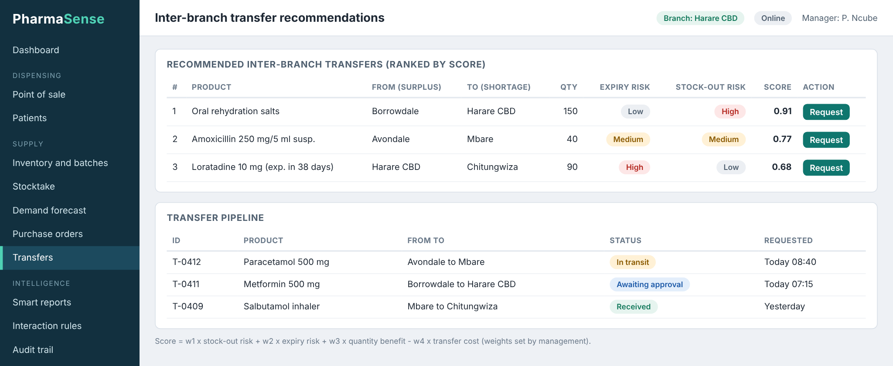

**Figure B.1:** Prototype: inter-branch transfer recommendations (sample data)

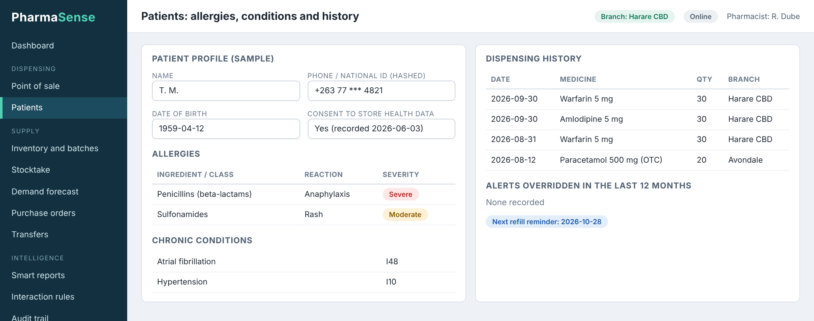

**Figure B.2:** Prototype: patient profile with allergies, conditions and current medicines (sample data)

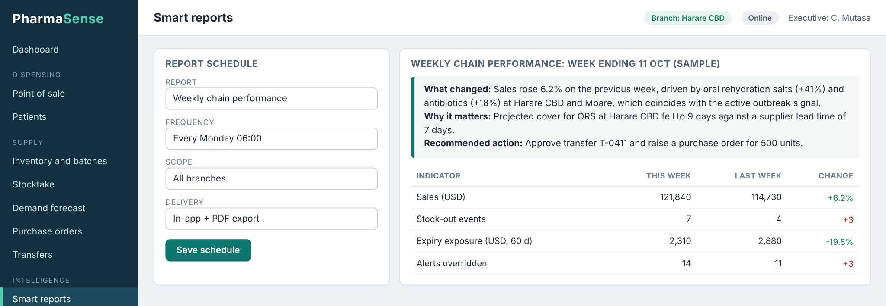

**Figure B.3:** Prototype: smart report with generated narrative (sample data)

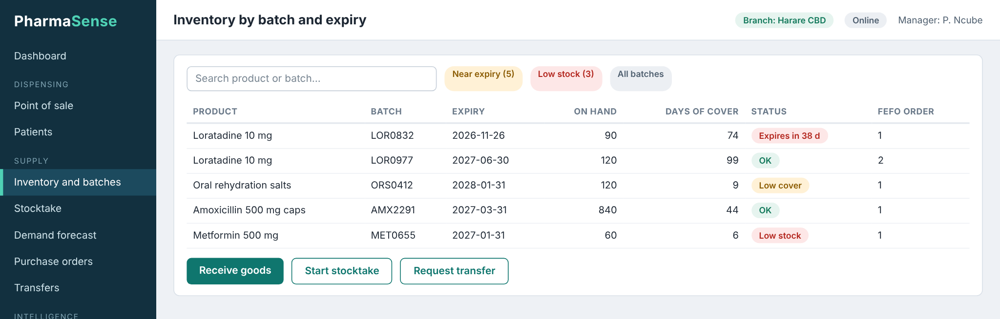

**Figure B.4:** Prototype: inventory by batch with expiry status (sample data)

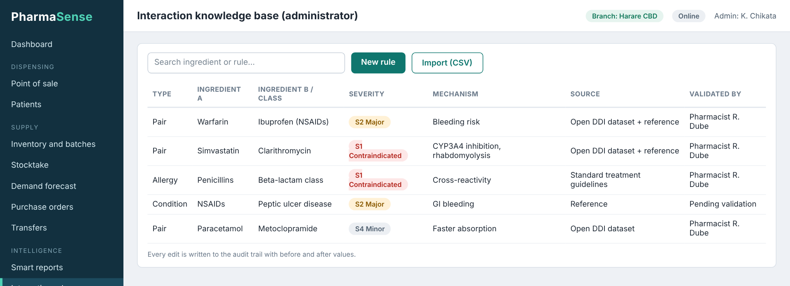

**Figure B.5:** Prototype: interaction rule maintenance and validation (sample data)

APPENDIX C: DETAILED ENTITY-RELATIONSHIP DIAGRAMS

The overview in Section 4.4.1 (Figure 4.8) is expanded here into four column-level diagrams. Stub entities (shaded) repeat only their keys.

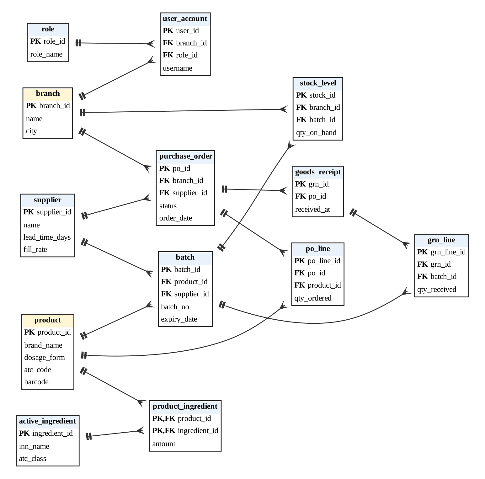

**Figure C.1:** ER diagram: master data, inventory and supply

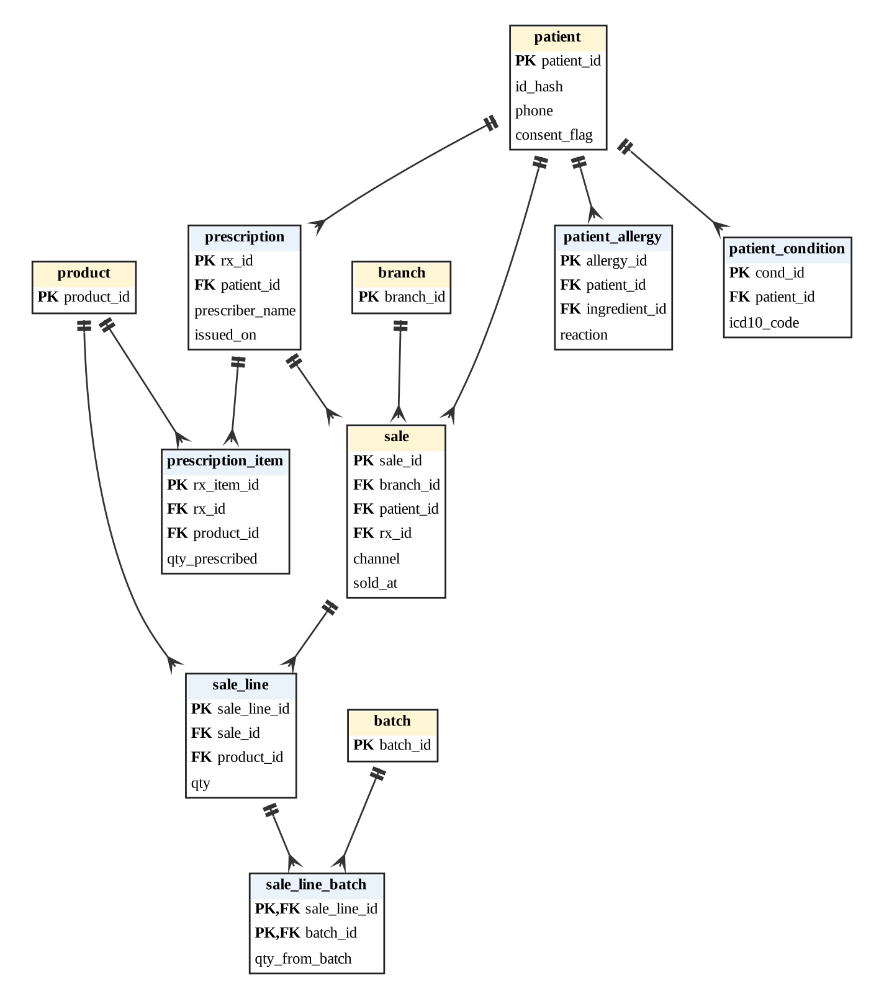

**Figure C.2:** ER diagram: patients, prescriptions and sales

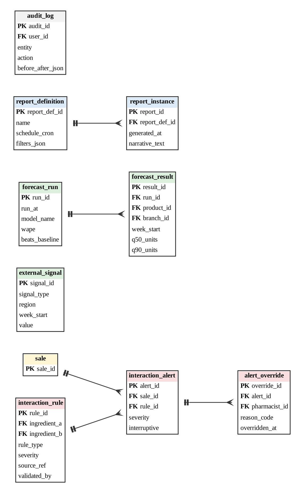

**Figure C.3:** ER diagram: interaction rules, alerts, forecasts, reports and audit

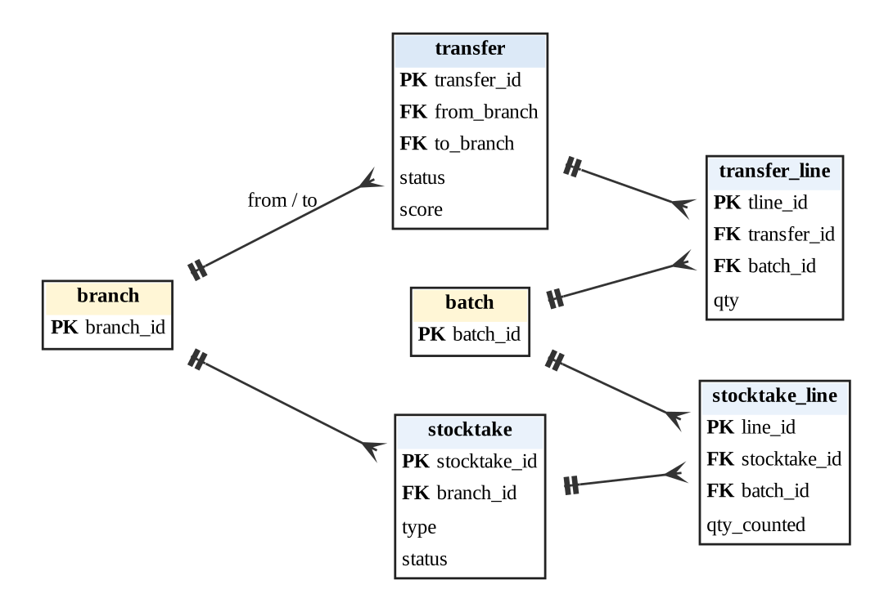

**Figure C.4:** ER diagram: transfers and stocktake
